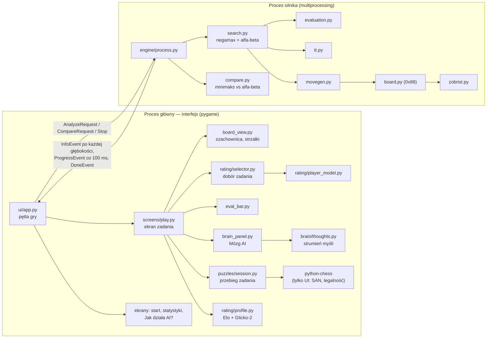
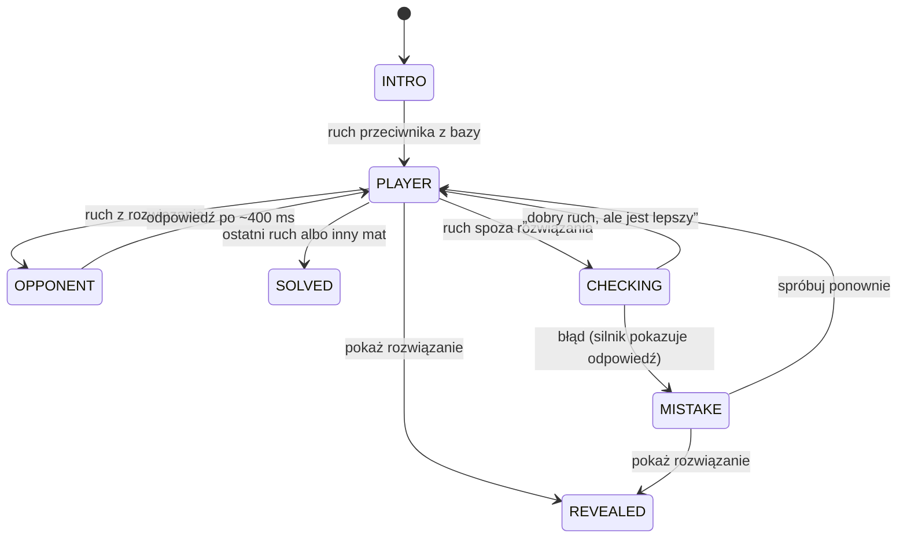

# TacticMind — szachowe zadania z AI, które myśli na głos

TacticMind to trener taktyki szachowej w stylu „Puzzles” z chess.com. Gracz rozwiązuje prawdziwe zadania z bazy
Lichess, a obok szachownicy panel **„Mózg AI”** pokazuje na żywo, co liczy **własny silnik szachowy** napisany
od zera w tym projekcie: głębokość, liczbę węzłów, cięcia alfa-beta, trzy najlepsze ruchy z wariantami,
mini-drzewo przeszukiwania i „strumień myśli” po polsku. Drugi element AI to **adaptacyjny ranking**
(Glicko-2 albo Elo) z **modelem gracza**, który dobiera kolejne zadania pod aktualny poziom i słabe strony gracza.

Stockfish ani żaden inny gotowy silnik **nie jest używany**. Biblioteka `python-chess` służy wyłącznie warstwie
interfejsu (notacja SAN, sprawdzenie legalności ruchu gracza); silnik ma własną planszę 0x88 i własny generator ruchów.

---

## Spis treści

1. [Uruchomienie](#uruchomienie)
2. [Jak grać](#jak-grać)
3. [Architektura](#architektura)
4. [Algorytmy](#algorytmy)
5. [Pomiary: minimaks vs alfa-beta](#pomiary-minimaks-vs-alfa-beta)
6. [Testy](#testy)
7. [Zadania z bazy Lichess](#zadania-z-bazy-lichess)
8. [Decyzje projektowe](#decyzje-projektowe)
9. [Etapy pracy](#etapy-pracy)
10. [Źródła i licencje](#źródła-i-licencje)

---

## Uruchomienie

Wymagania: **Python 3.11+** (projekt sprawdzony na Pythonie 3.14). Bez backendu i bez internetu — wszystko działa lokalnie.

```bash
python3 -m venv .venv
source .venv/bin/activate          # Windows: .venv\Scripts\activate
pip install -r requirements.txt    # pygame-ce, python-chess, pytest
python main.py                     # albo: python -m tacticmind
```

Testy:

```bash
python -m pytest
```

Postępy (ranking, historia, statystyki) zapisują się w pliku `~/.tacticmind/profile.json`
(inny katalog można wskazać zmienną `TACTICMIND_HOME`).

## Jak grać

- **Ekran startowy**: „Graj”, „Statystyki”, „Jak działa AI?”.
- **Zadanie**: pierwszy ruch wykonuje przeciwnik (z animacją), potem szukasz najlepszego ruchu. Szachownica jest
  obrócona na Twoją stronę. Ruch robisz przeciągnięciem albo klik-klik; kropki pokazują legalne pola, przy promocji
  pojawia się okno wyboru figury. Odpowiedzi przeciwnika wykonują się same po ok. 400 ms.
- **Informacja zwrotna**: turkusowy ✓ albo czerwony ✗ na polu docelowym i komunikaty „Najlepszy ruch!” /
  „Niestety, to nie to”. Po błędzie silnik wylicza odpowiedź przeciwnika, np. „Po Wd1? przeciwnik gra Hxh2#. Mat.”,
  a Ty wybierasz „Spróbuj ponownie” albo „Pokaż rozwiązanie”.
- **Genialny ruch (!!)**: jeśli poprawny ruch jest poświęceniem (oddajesz figurę za co najmniej 2 piony materiału,
  np. wieżę za piona), zamiast ✓ pojawia się cyjanowe „!!” z poświatą, iskrami i komunikatem „Genialny ruch!!” —
  jak na chess.com (`puzzles/validator.py: is_sacrifice`).
- **Cofanie się po ruchach**: przyciski ◀ ▶ pod szachownicą (albo klawisze ← →) działają przez całe zadanie —
  można wrócić do pozycji przed ruchem przeciwnika i zobaczyć, co się stało. Cofnięcie też jest animowane: figura
  płynnie wraca na swoje pole, zbita figura pojawia się z powrotem, a dźwięk odpowiada cofanemu ruchowi (bicie,
  szach, roszada…). Na wcześniejszej pozycji nie da się ruszyć ani zobaczyć podpowiedzi; ▶ do końca (albo kolejny
  ruch przeciwnika) wraca do bieżącej pozycji.
- **Przyciski**: w trakcie zadania widać „Podpowiedź” i „Pokaż rozwiązanie” (po błędzie także „Spróbuj ponownie”);
  „Następne zadanie” pojawia się dopiero po rozwiązaniu albo pokazaniu rozwiązania.
- **Alternatywne rozwiązania**: ruch inny niż wzorcowy, który daje mata, rozwiązuje zadanie. Ruch, który według
  silnika nadal wyraźnie wygrywa (ocena > +3 i najwyżej 0,5 piona gorzej od najlepszego), daje komunikat
  „Dobry ruch, ale jest lepszy. Spróbuj jeszcze raz” i nie jest liczony jako błąd.
- **Panel „Mózg AI”** ma trzy tryby:
  - *Ukryty* — w trakcie rozwiązywania widać tylko liczniki i to, że AI liczy,
  - *Podpowiedź* — podświetla figurę, którą trzeba ruszyć (nagroda rankingowa spada o połowę),
  - *Pełny* — po zadaniu (albo po błędzie) widać wszystko: pasek oceny, strzałki (najlepszy ruch turkusowy,
    drugi i trzeci półprzezroczyste), 3 linie kandydujące w SAN, strumień myśli, mini-drzewo, a AI tłumaczy zadanie.
    Kliknięcie linii kandydującej odtwarza ją na szachownicy w trybie podglądu.
- **Ranking**: duża liczba u góry (np. „1450 ± 80”) z animowaną zmianą (+12 turkusowo, −9 na czerwono),
  seria z ikoną ognia, ranking zadania widoczny po jego zakończeniu, okienko „Dlaczego to zadanie?”.
- Po zakończeniu zadania ◀ ▶ (albo ← →) przewijają pozycje, a silnik analizuje każdą z nich.
- **Strzałki i zaznaczenia (jak na chess.com)**: prawym przyciskiem myszy przeciągasz z pola na pole, żeby
  narysować strzałkę (ruch skoczka rysuje się jako litera L), a klikasz, żeby zaznaczyć pole. Shift = czerwony,
  Ctrl = niebieski, Alt = turkusowy, bez klawisza = bursztynowy. Ponowne narysowanie usuwa strzałkę, lewy klik
  na szachownicy albo wykonanie ruchu czyści rysunki.
- **Język**: przełącznik PL / EN w górnym pasku zmienia cały interfejs, także „myśli” AI, wyjaśnienia,
  nazwy motywów i litery figur w notacji (H/W/G/S po polsku, Q/R/B/N po angielsku). Wybór jest zapamiętywany.
- **Rozdzielczość i responsywność**: cały interfejs skaluje się do rozmiaru okna (od małego okna po 4K), a teksty
  dopasowują się do swoich pól (zmniejszają czcionkę albo skracają się „…”, zamiast wychodzić poza ramki).
  W szerokim oknie szachownica z panelem obok i pionowym paskiem oceny; w wąskim (jak telefon) dwuwierszowy górny
  pasek, poziomy pasek oceny nad szachownicą, panel pod nią, a cała strona przewija się kółkiem myszy.
- **Ikona**: okno ma własną ikonę (biały pion na turkusowo-fioletowym kafelku), rysowaną w kodzie;
  `python -m tacticmind.ui.icon` zapisuje ją jako `tacticmind/assets/icon.png` (np. do skrótu na pulpicie).
- **Dźwięki (w stylu chess.com)**: drewniane „puknięcie” przy ruchu, podwójne „klaśnięcie” przy biciu, dzwoneczek
  przy szachu, dwa puknięcia przy roszadzie, rosnący ton przy promocji, dzwonkowe arpeggio po rozwiązaniu zadania
  (jaśniejsze przy genialnym ruchu) i miękkie „bonk” po błędzie. Wszystkie są syntezowane w kodzie
  (`ui/sounds.py`), więc nie ma plików z cudzą licencją. Brzmią miękko: niskie, „ciepłe” tony drewna, filtr
  dolnoprzepustowy i lekkie echo, bez ostrych wysokich częstotliwości.
- **Głośność**: w górnym pasku jest suwak głośności (przeciągnij, kliknij albo kręć kółkiem myszy nad nim);
  ikona głośnika wycisza/włącza dźwięk. Głośność jest zapamiętywana w profilu.
- **Pełny ekran**: F11 albo przycisk ⛶ w prawym górnym rogu przełącza tryb pełnoekranowy; Esc z niego wychodzi.
- **Przeciąganie z „martwą strefą”**: figura zaczyna się przeciągać dopiero, gdy mysz odjedzie od miejsca kliknięcia
  o ok. 1/5 pola — drobne drgnięcie przy kliknięciu nie „łapie” figury, tylko ją zaznacza (klik-klik).
- **Wygląd i animacje**: własny ciemny motyw (granat + turkus dla gracza + fiolet dla AI) i szachownica w stalowych
  błękitach. Wszystkie kształty są wygładzane (supersampling), karty mają miękkie cienie. Animacje: płynny ruch figur
  (bita figura znika), wyskakujący ✓/✗ z falą, potrząśnięcie szachownicą po błędzie, konfetti po rozwiązaniu,
  pulsująca podpowiedź i szach, sprężysty pasek oceny, przenikanie ekranów, przesuwające się wskaźniki przełączników.

## Architektura

```
main.py                     # start gry
tacticmind/
  engine/                   # WŁASNY SILNIK (czysty Python, bez pygame)
    constants.py            #   kody figur, kodowanie ruchów, tablice pól 0x88
    zobrist.py              #   klucze haszowania Zobrista
    board.py                #   plansza 0x88, FEN, make/unmake, przyrostowy hasz i ocena
    movegen.py              #   generator ruchów, szach/mat/pat, perft
    pst.py, evaluation.py   #   funkcja oceny (tapered PST, mobilność, król, piony)
    tt.py                   #   tablica transpozycji
    search.py               #   negamax + alfa-beta, ID, quiescence, MultiPV, statystyki
    compare.py              #   tryb porównawczy: minimaks / alfa-beta / alfa-beta + porządkowanie
    process.py              #   silnik w osobnym procesie + protokół wiadomości
    types.py                #   SearchInfo, EngineScore, TreeNode…
  rating/                   # elo.py, glicko2.py, player_model.py, selector.py, profile.py
  puzzles/                  # loader.py, themes.py (tłumaczenia), validator.py, session.py
  brain/                    # notation.py (SAN w języku interfejsu), thoughts.py (strumień myśli), demo.py
  i18n/                     # tłumaczenia: pl.py, en.py (jeden słownik na język) + liczba mnoga, formaty liczb
  ui/                       # pygame: app, board_view (z rysowaniem strzałek), eval_bar, brain_panel, topbar,
                            #   charts, sounds, screens/, a także scale.py (skalowanie), gfx.py (wygładzona
                            #   grafika, cienie), anim.py (wygładzanie animacji), effects.py (konfetti, fale)
  data/                     # starter_puzzles.json (50 zadań), puzzles.json (3000 zadań)
  assets/fonts/             # fonty Noto (tekst i symbole figur)
scripts/build_puzzles.py    # budowa zestawu zadań z bazy Lichess
scripts/benchmark.py        # pomiary do tabeli w README
tests/                      # pytest
```

Logika gry i silnik są oddzielone od interfejsu: `engine/`, `rating/`, `puzzles/` i `brain/` to czyste
moduły bez pygame, testowane jednostkowo. Interfejs tylko je wywołuje i rysuje wyniki.



**Protokół silnika** (`engine/process.py`): po każdej ukończonej głębokości proces wysyła `InfoEvent` z obiektem
`SearchInfo` = `{ depth, score (cp lub mat), pv, multi_pv, nodes, nps, cutoffs, tt_hits, time_ms, tree }`.
Co ok. 100 ms przychodzi `ProgressEvent` (liczniki na żywo w trakcie głębokości). Komenda `stop` ustawia
współdzieloną flagę `multiprocessing.Event`, którą wyszukiwanie sprawdza co 1024 węzły — przerwanie jest
natychmiastowe, a proces obsługuje kolejne zapytania bez restartu.

Przebieg zadania (`puzzles/session.py`):



## Algorytmy

### Reprezentacja planszy 0x88 i generator ruchów

Plansza to tablica 128 pól (16 kolumn × 8 rzędów); używamy tylko kolumn 0–7. Indeks = `rząd·16 + kolumna`.
Sztuczka 0x88: pole leży na planszy wtedy i tylko wtedy, gdy `(pole & 0x88) == 0` — wyjście poza planszę
wykrywa jedna operacja bitowa. Na tej podstawie raz przy starcie liczymy listy pól dla skoczków, króla
i promieni gońców/wież, z których korzysta generator. Ruch to jedna liczba całkowita
(pole startowe, docelowe, figura promocji, flagi: bicie, en passant, roszada, podwójny ruch piona).

Generator tworzy ruchy pseudolegalne (z roszadami, biciem w przelocie i promocjami na 4 figury), a legalność
sprawdzamy po wykonaniu ruchu: jeśli własny król jest atakowany, ruch cofamy (`make_legal_move`).
`make_move`/`unmake_move` zapisują na stosie wszystko, czego nie da się odtworzyć z ruchu (zbitą figurę,
prawa do roszady, pole en passant, licznik 50 ruchów, hasz). Poprawność generatora potwierdza **perft** —
liczba liści drzewa ruchów zgadza się z wartościami referencyjnymi dla 5 pozycji (testy w `tests/test_perft.py`).

### Minimaks (negamax)

Zakładamy, że obie strony grają najlepiej: my maksymalizujemy ocenę, przeciwnik ją minimalizuje. Wersja
**negamax** korzysta z tożsamości `max(a, b) = −min(−a, −b)`: ocena pozycji dla strony na ruchu to minus
najlepsza ocena przeciwnika po każdym z naszych ruchów. Wystarcza jedna funkcja.

```
funkcja negamax(pozycja, głębokość):
    jeśli głębokość == 0: zwróć ocena(pozycja)        # z perspektywy strony na ruchu
    najlepszy = −∞
    dla każdego legalnego ruchu:
        wykonaj ruch
        najlepszy = max(najlepszy, −negamax(pozycja, głębokość − 1))
        cofnij ruch
    jeśli brak ruchów: zwróć (szach ? −MAT + ply : 0)   # mat albo pat
    zwróć najlepszy
```

Minimaks odwiedza ok. `b^d` węzłów (b ≈ 30–35 ruchów, d = głębokość) — na głębokości 5 to dziesiątki milionów.

### Alfa-beta

Alfa-beta daje **ten sam wynik** co minimaks, ale pomija gałęzie, które nie mogą zmienić decyzji.
`α` = wynik, który strona na ruchu ma już zagwarantowany; `β` = najlepszy wynik, na jaki pozwoli jej przeciwnik.
Gdy któryś ruch daje wynik ≥ β, przeciwnik nie dopuści do tej pozycji — pozostałych ruchów nie liczymy
(**cięcie β**).

```
funkcja alfabeta(pozycja, głębokość, α, β, ply):
    jeśli remis (powtórzenie, 50 ruchów): zwróć 0
    jeśli szach: głębokość += 1                       # przedłużenie szacha
    jeśli głębokość <= 0: zwróć quiescence(pozycja, α, β)
    sprawdź tablicę transpozycji (może od razu dać wynik albo najlepszy ruch)
    najlepszy = −∞
    dla każdego ruchu w kolejności: TT/PV, bicia MVV-LVA, killery, history:
        jeśli ruch nielegalny: pomiń
        wykonaj ruch
        wynik = −alfabeta(pozycja, głębokość − 1, −β, −α, ply + 1)
        cofnij ruch
        jeśli wynik > najlepszy:
            najlepszy = wynik
            jeśli wynik > α:
                α = wynik; zapamiętaj wariant (PV)
                jeśli wynik >= β:                     # cięcie β
                    zapamiętaj ruch jako killer/history; przerwij pętlę
    jeśli brak legalnych ruchów: zwróć (szach ? −MAT + ply : 0)
    zapisz w TT (dokładny / dolna granica / górna granica)
    zwróć najlepszy
```

Przy idealnej kolejności ruchów alfa-beta odwiedza ok. `b^(d/2)` węzłów — w tym samym czasie liczy prawie
dwa razy głębiej. Dlatego tak ważne jest **porządkowanie ruchów**:

1. ruch z głównego wariantu / tablicy transpozycji (najlepszy z płytszej iteracji),
2. bicia wg **MVV-LVA** (najcenniejsza ofiara, najtańszy napastnik), promocje na hetmana,
3. **ruchy killer** — dwa ciche ruchy na poziom, które niedawno dały cięcie,
4. **history heuristic** — punkty `głębokość²` dla ruchów (figura → pole), które dawały cięcia.

Ruchy wybieramy leniwie (sortowanie przez wybór): po cięciu resztę listy i tak pomijamy.

### Iterative deepening

Silnik liczy głębokość 1, potem 2, 3… aż do limitu czasu albo głębokości. Płytkie iteracje są tanie, a ich
najlepszy wariant porządkuje ruchy w głębszej — dzięki temu cięć jest więcej niż przy jednym przeszukaniu
od razu na docelowej głębokości. Po każdej ukończonej głębokości silnik wysyła wynik do interfejsu
(stąd „myśli” na żywo). Nowej głębokości nie zaczynamy, jeśli zużyto ponad połowę czasu.
Gdy znaleziony jest mat w `n` półruchach, a głębokość ≥ `n`, wyszukiwanie kończy się (krótszego mata już nie ma).

### Quiescence search

Ocena w połowie wymiany jest fałszywa (np. hetman właśnie zbił piona, ale zaraz zostanie zbity) — to **efekt
horyzontu**. Dlatego w liściach dogrywamy bicia i promocje, aż pozycja się uspokoi:

```
funkcja quiescence(pozycja, α, β):
    jeśli szach: rozważ wszystkie ruchy (żeby nie przeoczyć mata)
    inaczej:
        stand_pat = ocena(pozycja)                     # strona na ruchu może nie bić
        jeśli stand_pat >= β: zwróć stand_pat
        α = max(α, stand_pat)
    dla każdego bicia/promocji (MVV-LVA):
        pomiń bicia, które nie mogą podnieść α (delta pruning)
        pomiń „złe bicia” (droższa figura bije tańszą na bronionym polu)
        wynik = −quiescence(po ruchu, −β, −α)
        aktualizuj α, cięcie gdy wynik >= β
```

Tabela pomiarów poniżej (bez quiescence, stała głębokość) dobrze pokazuje efekt horyzontu: ocena debiutu
skacze między −2,1 a +1,4 zależnie od tego, czy głębokość kończy się w połowie wymiany.

### Tablica transpozycji i haszowanie Zobrista

Każdej figurze na każdym polu, stronie na ruchu, prawom do roszady i polu en passant przypisujemy losową liczbę
64-bitową (stałe ziarno). Hasz pozycji to XOR tych liczb; przy ruchu aktualizujemy go kilkoma operacjami XOR.
Tablica transpozycji (`tt.py`) przechowuje dla hasza: głębokość, ocenę, typ oceny (**dokładna**, **dolna**
granica po cięciu β, **górna** granica, gdy żaden ruch nie poprawił α) i najlepszy ruch. Wyniki matowe zapisujemy
względem bieżącego węzła (a nie korzenia), żeby odległość do mata była poprawna po odczycie z innej głębokości.
Hasze służą też do wykrywania powtórzeń pozycji (remis).

### Wyniki matowe

Mat ma ocenę `±(32000 − liczba półruchów od korzenia)`, więc **szybszy mat jest zawsze lepszy**, a przy
obronie silnik wybiera najdłuższą drogę do mata. Interfejs pokazuje to jako `M3` / `−M2`.

### Funkcja oceny

Ocena w centypionach (100 = pion):

- **materiał** i **tablice pozycyjne** (PST) — osobne wartości dla gry środkowej (mg) i końcówki (eg),
- **tapered eval** — wynik = `(mg·faza + eg·(24 − faza)) / 24`, gdzie faza zależy od liczby figur
  (skoczek/goniec 1, wieża 2, hetman 4). Król w środkowej grze chowa się, w końcówce idzie do centrum,
- **mobilność** — premia za każde dostępne pole ponad typową liczbę (osobno dla figur i faz),
- **bezpieczeństwo króla** — osłona pionków przed królem, kara za otwarte/półotwarte linie, „tropizm” (wrogie
  figury blisko króla),
- **struktura pionków** — zdwojone, izolowane, przechodnie (premia rośnie z każdym rzędem),
- **para gońców**, wykrywanie remisu z braku materiału.

Materiał i PST plansza sumuje przyrostowo w `make_move`, więc liść kosztuje tylko składniki zależne od układu figur.
Ocena dla silnika jest z perspektywy strony na ruchu (wymóg negamaksu); interfejs zawsze pokazuje ją
**z perspektywy białych** (np. +1.5 albo M3).

### MultiPV (3 najlepsze ruchy)

Zamiast liczyć korzeń trzy razy, robimy to w jednym przebiegu: dla kolejnego ruchu z korzenia α = wynik
**trzeciego** najlepszego ruchu znalezionego do tej pory. Ruchy z pierwszej trójki dostają więc dokładne oceny
i warianty, a gorsze są szybko odcinane (fail-low).

### Statystyki i mini-drzewo

Silnik liczy na bieżąco: głębokość (i maksymalną głębokość selektywną), węzły, węzły/s, cięcia β, trafienia TT,
odsetek pominiętych ruchów i czas. Dla ostatniej głębokości zapisuje pierwsze dwa poziomy drzewa: ruchy
z korzenia z ocenami (dokładnymi albo „≤” po fail-low) i odpowiedzi przeciwnika — gałęzie odcięte przez alfa-betę
są w panelu wyszarzone i przekreślone.

### Strumień myśli

`brain/thoughts.py` zamienia kolejne wyniki silnika na zdania po polsku za pomocą szablonów (bez żadnego LLM),
np. „Głębokość 4: nadal Hxf7+ (+3.2). Po Kxf7 Sg5+ wygrywam hetmana.”, „Zmieniam zdanie! Na głębokości 6 widzę
mata w 3 po Wd8+.”, „Dzięki alfa-beta pomijam 84% gałęzi.”. Komentarz o zysku materiału wynika z przeliczenia
materiału na końcu wariantu PV. Zmiana najlepszego ruchu między głębokościami jest wyróżniona kolorem.

### Ranking: Elo i Glicko-2

Zadanie traktujemy jak przeciwnika o rankingu zadania.

- Oczekiwany wynik: `E = 1 / (1 + 10^((R_zadania − R_gracza) / 400))`
- Zmiana rankingu Elo: `ΔR = K · (S − E)`; K = 60 przez pierwsze 10 zadań (kalibracja), potem 32, po 50 zadaniach 20.
- Wynik `S`: 1,0 — bez błędu i podpowiedzi; 0,5 — z podpowiedzią; 0,0 — błędny ruch (nawet jeśli gracz potem
  dokończy zadanie) albo pokazane rozwiązanie. Kara za bardzo długi czas: powyżej 3× przeciętnego czasu gracza
  liniowo do −0,2 (przy 6×).
- **Glicko-2** (bonus, domyślny system): oprócz rankingu `r` gracz ma odchylenie `RD` i zmienność `σ`.
  Implementacja według artykułu Glickmana (przeliczenie na skalę μ/φ, wariancja v, poprawa Δ, nowa zmienność
  metodą Illinois, nowe φ i μ); test sprawdza przykład z artykułu (1500/200 → 1464,06 / 151,52).
  Jedno zadanie = jeden okres rankingowy; RD zadania pochodzi z bazy Lichess. Interfejs pokazuje „1450 ± 80”
  (± RD), a wykres rankingu ma pas niepewności. System można przełączyć na Elo w statystykach.

### Dobór zadań i model gracza

`rating/selector.py`:

- **strefa flow** — celujemy w ok. 65% szans: ranking zadania ≈ `R_gracza − 100` (bo E(−100) ≈ 0,64)
  z losowym rozrzutem ±75,
- **model gracza** (`player_model.py`) liczy skuteczność w każdym motywie (widełki, związania, maty…),
  z wygładzaniem Bayesa (jedno nieudane zadanie nie robi z motywu słabej strony); ok. **30%** zadań pochodzi
  z najsłabszych motywów,
- **ochrona przed frustracją** — po 3 porażkach z rzędu zadanie wyraźnie łatwiejsze (≈ R − 300); po 5 sukcesach
  z rzędu **zadanie bonusowe** (≈ R + 200),
- zadania się nie powtarzają, a motywy z ostatnich 3 zadań dostają karę (różnorodność),
- każda decyzja ma uzasadnienie w okienku **„Dlaczego to zadanie?”**, np. „Ranking zadania ok. 1380, celuję
  w 65% szans (strefa flow). Twoja słaba strona: związanie (41%).”

## Pomiary: minimaks vs alfa-beta

Ta sama pozycja, ta sama głębokość i ta sama funkcja oceny (bez quiescence i bez tablicy transpozycji),
więc wynik wszystkich trzech wariantów jest identyczny — różni się tylko liczba odwiedzonych węzłów.
Pomiar: `python scripts/benchmark.py` (CPython 3.14, jeden rdzeń). Minimaks na głębokości 5 w debiucie
pominięto — szacunkowo ok. 28,6 mln węzłów (kilkanaście minut w Pythonie).

**Debiut włoski (gra środkowa)** — `r1bqkbnr/pppp1ppp/2n5/4p3/2B1P3/5N2/PPPP1PPP/RNBQK2R b KQkq - 3 3` (31 legalnych ruchów)

| Głębokość | Minimaks | Alfa-beta | Alfa-beta + porządkowanie | Oszczędność alfa-bety | Oszczędność z porządkowaniem | Ocena |
|---:|---:|---:|---:|---:|---:|:---:|
| 1 | 32 (0,00 s) | 32 (0,00 s) | 32 (0,00 s) | 0,0% | 0,0% | −0.2 |
| 2 | 1 048 (0,04 s) | 660 (0,02 s) | 285 (0,01 s) | 37,0% | 72,8% | +1.3 |
| 3 | 32 072 (1,04 s) | 2 762 (0,09 s) | 2 076 (0,07 s) | 91,4% | 93,5% | −2.1 |
| 4 | 1 040 115 (33,24 s) | 60 313 (1,86 s) | 15 488 (0,48 s) | 94,2% | 98,5% | +1.4 |
| 5 | — (ok. 28,6 mln) | 792 174 (24,84 s) | 73 121 (2,23 s) | — | 90,8% względem alfa-bety | −1.8 |

**Końcówka (pozycja 3 z Chess Programming Wiki)** — `8/2p5/3p4/KP5r/1R3p1k/8/4P1P1/8 w - - 0 1` (14 legalnych ruchów)

| Głębokość | Minimaks | Alfa-beta | Alfa-beta + porządkowanie | Oszczędność alfa-bety | Oszczędność z porządkowaniem | Ocena |
|---:|---:|---:|---:|---:|---:|:---:|
| 1 | 15 (0,00 s) | 15 (0,00 s) | 15 (0,00 s) | 0,0% | 0,0% | +1.2 |
| 2 | 206 (0,00 s) | 131 (0,00 s) | 30 (0,00 s) | 36,4% | 85,4% | +0.9 |
| 3 | 3 018 (0,05 s) | 503 (0,01 s) | 394 (0,01 s) | 83,3% | 86,9% | +1.5 |
| 4 | 46 256 (0,71 s) | 1 733 (0,03 s) | 1 047 (0,02 s) | 96,3% | 97,7% | −0.1 |
| 5 | 720 880 (11,13 s) | 32 498 (0,49 s) | 6 946 (0,11 s) | 95,5% | 99,0% | +1.8 |

Wnioski:

- na głębokości 1 cięć nie ma (liście nie mają rodzeństwa do odcięcia), od głębokości 3 alfa-beta pomija > 80% węzłów,
- porządkowanie ruchów zbliża alfa-betę do ideału `b^(d/2)`: na głębokości 5 w debiucie 73 tys. zamiast 792 tys. węzłów,
- skaczące oceny (−2.1 / +1.4 / −1.8) to efekt horyzontu przy stałej głębokości — dlatego właściwy silnik gry
  używa quiescence search.

Pełny silnik (z iterative deepening, TT i quiescence) liczy w Pythonie ok. 25–60 tys. węzłów/s; w typowym
zadaniu dochodzi do głębokości 6–9 w kilka sekund, a maty w 3 znajduje w ok. 0,1 s (głębokość 3 z przedłużeniem
szacha) i potwierdza do 2 s. To samo porównanie można uruchomić interaktywnie na stronie „Jak działa AI?”.

## Testy

`python -m pytest` — 94 testy, m.in.:

| Plik | Co sprawdza |
|---|---|
| `test_perft.py` | perft z pozycji startowej (1–4: 20, 400, 8 902, 197 281), Kiwipete (1–3: 48, 2 039, 97 862), pozycja 3 (1–4: 14, 191, 2 812, 43 238) oraz pozycje 4 i 5 z CPW; zgodność FEN i przyrostowego hasza/oceny |
| `test_search.py` | maty w 1, 2 i 3 (pozycje klasyczne i z bazy Lichess, także dla czarnych), szybszy mat, pat/mat w korzeniu, MultiPV, statystyki, drzewo, przerwanie, minimaks = alfa-beta przy mniejszej liczbie węzłów |
| `test_engine_process.py` | proces silnika: `info` po każdej głębokości, przerwanie nowym zapytaniem, tryb porównawczy |
| `test_rating.py` | E i ΔR Elo dla przykładowych wartości, K w kalibracji, przykład Glicko-2 z artykułu, wynik S i kara za czas, profil i zapis |
| `test_selector.py` | selektor trafia w docelowy przedział rankingu, łatwiejsze zadanie po 3 porażkach, bonus po 5 sukcesach, ~30% słabych motywów, brak powtórek, różnorodność |
| `test_puzzles.py` | dane Lichess (każdy ruch legalny w naszym generatorze i w python-chess), przebieg zadania, inny mat, „dobry ruch, ale jest lepszy”, notacja polska, strumień myśli |
| `test_i18n.py` | każdy język ma komplet kluczy i te same pola `{…}`, liczba mnoga (polska: 1/2–4/5+), formaty liczb, litery figur |
| `test_ui_smoke.py` | gra uruchomiona bez okna: rozwiązanie zadania, błąd, genialny ruch, cofanie ◀ ▶ (z animacją przywracającą zbitą figurę), martwa strefa przeciągania, dźwięki, suwak głośności i pełny ekran, zmiana języka w trakcie zadania, wszystkie ekrany w rozdzielczościach od 430×640 do 2560×1440, rysowanie strzałek prawym przyciskiem; demonstracja alfa-bety |

Kod jest sprawdzany także narzędziami `ruff` i `mypy` (typy we wszystkich funkcjach, bez `type: ignore`
w kodzie gry):

```bash
pip install -r requirements-dev.txt
ruff check .
mypy tacticmind scripts main.py --disallow-untyped-defs
```

## Zadania z bazy Lichess

Baza: <https://database.lichess.org/lichess_db_puzzle.csv.zst> (licencja **CC0**). Kolumny:
`PuzzleId,FEN,Moves,Rating,RatingDeviation,Popularity,NbPlays,Themes,GameUrl,OpeningTags`.

```bash
# pobierz bazę (ok. 300 MB), potem:
python scripts/build_puzzles.py lichess_db_puzzle.csv.zst                 # 3000 zadań → tacticmind/data/puzzles.json
python scripts/build_puzzles.py lichess_db_puzzle.csv.zst --count 50 --out tacticmind/data/starter_puzzles.json
```

Skrypt bierze zadania z `Popularity > 80` i `NbPlays > 500` o rankingu 600–2800, dzieli je na koszyki co 100 punktów,
z każdego koszyka losuje tyle samo zadań (reservoir sampling ze stałym ziarnem), preferując rzadkie motywy,
i sprawdza legalność wszystkich ruchów. Plik `.zst` czyta modułem `compression.zstd` z Pythona 3.14
(w starszym Pythonie wystarczy go rozpakować: `unzstd`).

W repozytorium są oba pliki: **zestaw startowy** (50 prawdziwych zadań, rankingi 649–2784, ponad 50 motywów)
i **pełny zestaw** 3000 zadań. Gra używa pełnego zestawu, a gdy go nie ma — startowego.

Uwaga na format Lichess: `FEN` to pozycja **przed** ruchem przeciwnika; pierwszy ruch z `Moves` wykonuje przeciwnik,
a gracz gra stroną, która jest na ruchu po nim (szachownica obraca się na jego stronę).

## Decyzje projektowe

1. **Python + pygame zamiast Vite/React/TypeScript.** Pierwotna specyfikacja (PROMPT.md) zakładała stos webowy;
   na życzenie zamawiającego całość jest w Pythonie. Odpowiedniki: `react-chessboard` → własna szachownica
   w pygame (`ui/board_view.py`: przeciąganie, klik-klik, kropki, promocja, animacje, strzałki); `chess.js` →
   `python-chess` (tylko interfejs); Web Worker → osobny proces `multiprocessing`; Recharts → własne wykresy
   (`ui/charts.py`); Vitest → pytest; localStorage → plik JSON w katalogu domowym; Tailwind → `ui/theme.py`;
   TypeScript strict → adnotacje typów + mypy (`--disallow-untyped-defs`).
2. **0x88 + legalność przez sprawdzenie króla.** Prostsze i pewniejsze niż wykrywanie związań; potwierdzone perftem.
3. **Przyrostowy hasz i ocena** (materiał + PST) w `make_move` — w czystym Pythonie to największa oszczędność
   w liściach.
4. **Proces zamiast wątku** dla silnika: wątki Pythona dzielą GIL i przycinałyby animacje; osobny proces liczy
   na innym rdzeniu. Start „spawn” działa tak samo na Linuksie, Windowsie i macOS.
5. **Przerwanie liczenia**: flaga `multiprocessing.Event` sprawdzana co 1024 węzły + wykrywanie nowego zapytania
   w kolejce. Przerwanie w środku drzewa cofa wszystkie wykonane ruchy, wynik ostatniej pełnej głębokości zostaje.
6. **MultiPV w jednym przebiegu** (α = wynik 3. najlepszego ruchu) zamiast trzykrotnego liczenia korzenia.
7. **Bez null-move pruning i LMR** — przyspieszyłyby silnik, ale utrudniają wyjaśnienie algorytmu i psują
   zadania z zugzwangiem (częste w końcówkach). Zamiast tego: przedłużenie szacha, delta pruning i pomijanie
   złych bić w quiescence.
8. **Glicko-2 jako domyślny system** (bonus ze specyfikacji), z możliwością przełączenia na Elo w statystykach.
   Oba rankingi liczone są zawsze, więc przełączenie nie traci danych. Minimalne RD = 50 (bez tego po setkach
   zadań ranking prawie przestałby się zmieniać). „± RD” to jedno odchylenie standardowe.
9. **Wynik zadania ustalany raz**: przy rozwiązaniu, pierwszym błędzie albo pokazaniu rozwiązania (jak na
   chess.com). Po błędzie można dokończyć zadanie, ale ranking już się nie zmienia; panel przechodzi w tryb
   Pełny, żeby AI wyjaśniło, co poszło nie tak.
10. **Tryb Pełny w trakcie rozwiązywania** zdradza rozwiązanie, więc wymaga potwierdzenia i liczy zadanie jako
    nierozwiązane. Przejście do następnego zadania jest możliwe dopiero po jego rozstrzygnięciu.
11. **„Dobry ruch, ale jest lepszy”**: jeśli ruch gracza jest wśród 3 linii MultiPV, używamy jego oceny z tej
    samej głębokości co najlepszy ruch; w przeciwnym razie silnik osobno liczy pozycję po ruchu (1,6 s). Ta sama
    analiza daje odpowiedź przeciwnika pokazywaną po błędzie.
12. **Ranking zadania ukryty do końca** (jak na chess.com); okienko „Dlaczego to zadanie?” podaje docelowy
    ranking („ok. 1380”), a dokładny widać po zakończeniu.
13. **Kara za czas** liczona od przeciętnego czasu z ostatnich 20 rozwiązanych zadań (co najmniej 3), liniowo od
    3× do 6× średniej (maks. −0,2).
14. **Figury z symboli Unicode** (czcionka Noto Sans Symbols 2) i **dźwięki syntezowane w kodzie** — żadnych
    plików graficznych ani dźwiękowych z niejasną licencją. Dźwięki powstają w formacie, w jakim system otworzył
    kartę dźwiękową (mono/stereo), w osobnym wątku przy starcie, z małym buforem (niskie opóźnienie). Suwak
    głośności działa z krzywą kwadratową (głośność = wartość²), bo ucho odbiera głośność logarytmicznie — dzięki
    temu połowa suwaka to wyraźnie ciszej, a nie prawie tak samo głośno. Symbole króla i hetmana są w tej czcionce wąskie,
    więc poszerzamy je w poziomie (×1,22 i ×1,14) podczas zmniejszania z podwójnej rozdzielczości.
15. **Notacja w języku interfejsu** (po polsku K, H, W, G, S; po angielsku K, Q, R, B, N) w panelu i komunikatach;
    silnik i protokół używają UCI.
16. **Responsywność i skalowanie**: interfejs jest projektowany dla okna 1360×860 (albo 560×1000 w układzie
    wąskim), a wszystkie wymiary i czcionki mnożymy przez współczynnik zależny od rozmiaru okna (`ui/scale.py`).
    Teksty dopasowują się do pól funkcjami `fonts.fit` / `fonts.fit_wrapped` (najpierw mniejsza czcionka,
    potem „…”), a ich układ jest zapamiętywany, żeby nie liczyć go 60 razy na sekundę.
    Szeroki układ (panel obok) albo wąski jak na telefonie (panel pod
    szachownicą, poziomy pasek oceny, przewijana strona).
17. **Dwa zestawy zadań w repozytorium**: zestaw startowy wymagany przez specyfikację oraz pełny zestaw
    3000 zadań wygenerowany skryptem, żeby dobór zadań miał z czego wybierać bez pobierania bazy.
18. **Własny wygląd zamiast kopii chess.com**: granatowe tło, turkus jako kolor gracza, fiolet jako kolor AI,
    stalowo-niebieska szachownica. Jakość: wszystkie kształty (zaokrąglone karty, koła, strzałki, ikony) rysujemy
    w potrójnej rozdzielczości i zmniejszamy filtrem (`ui/gfx.py`), figury w podwójnej. Gotowe kształty trafiają
    do pamięci podręcznej w formacie ekranu — interfejs mieści się w 60 kl./s nawet przy 2560×1440.
19. **Tłumaczenia jako słowniki** (`tacticmind/i18n/`): każdy język to jeden plik z kluczami; brakujący klucz spada
    na polski. Komunikaty na ekranie gry są przechowywane jako funkcje zwracające tekst, a strumień myśli jest
    odtwarzany z zapisanych wyników silnika — dzięki temu zmiana języka działa natychmiast, także w trakcie zadania.
    Żeby dodać język, wystarczy skopiować `en.py`, przetłumaczyć wartości i dopisać kod w `i18n/__init__.py`.
20. **Strzałki gracza** działają jak na chess.com/lichess (prawy przycisk, kolory z Shift/Ctrl/Alt, L dla skoczka)
    i znikają po ruchu, żeby nie myliły się ze strzałkami silnika.

## Etapy pracy

1. **Szkielet, szachownica, zadania** — pakiet `tacticmind`, okno pygame, własna szachownica, zestaw startowy
   i przebieg zadania (`puzzles/session.py`).
2. **Silnik: plansza i generator** — 0x88, FEN, make/unmake, Zobrist, perft (wszystkie wartości referencyjne zgodne).
3. **Wyszukiwanie** — ocena, negamax + alfa-beta, ID, quiescence, TT, MultiPV, proces silnika, testy matów.
4. **Panel „Mózg AI”** — pasek oceny, strzałki, liczniki na żywo, linie kandydujące, strumień myśli, drzewo, tryby widoczności.
5. **Ranking i dobór zadań** — Elo, Glicko-2, model gracza, selektor, okienko „Dlaczego to zadanie?”.
6. **Statystyki, ekran startowy, „Jak działa AI?”** — wykresy, porównanie na żywo, demonstracja alfa-bety krok
   po kroku, dźwięki, animacje, responsywność.
7. **Skrypt `build_puzzles.py` i README** — 3000 zadań z bazy Lichess, pomiary `scripts/benchmark.py`.
8. **Druga wersja interfejsu** — własny wygląd (zamiast podobnego do chess.com), wygładzona grafika, skalowanie
   do rozdzielczości okna i dopasowanie tekstów, nowe animacje, język angielski (system tłumaczeń gotowy na kolejne
   języki), strzałki i zaznaczenia rysowane prawym przyciskiem myszy.

## Źródła i licencje

- Zadania: [baza zadań Lichess](https://database.lichess.org/#puzzles), licencja **CC0** (domena publiczna).
  Każde zadanie ma link do partii źródłowej (`url`).
- Wartości perft: [Chess Programming Wiki — Perft Results](https://www.chessprogramming.org/Perft_Results).
- Glicko-2: M. E. Glickman, *Example of the Glicko-2 system* (glicko.net).
- Tablice pozycyjne oparte na „Simplified Evaluation Function” (T. Michniewski, Chess Programming Wiki),
  rozszerzone o wartości dla końcówki.
- Fonty Noto (Google) — licencja w `tacticmind/assets/fonts/`.
- Biblioteki: [pygame-ce](https://pyga.me/) (LGPL), [python-chess](https://python-chess.readthedocs.io/) (GPL-3.0, tylko warstwa interfejsu).
