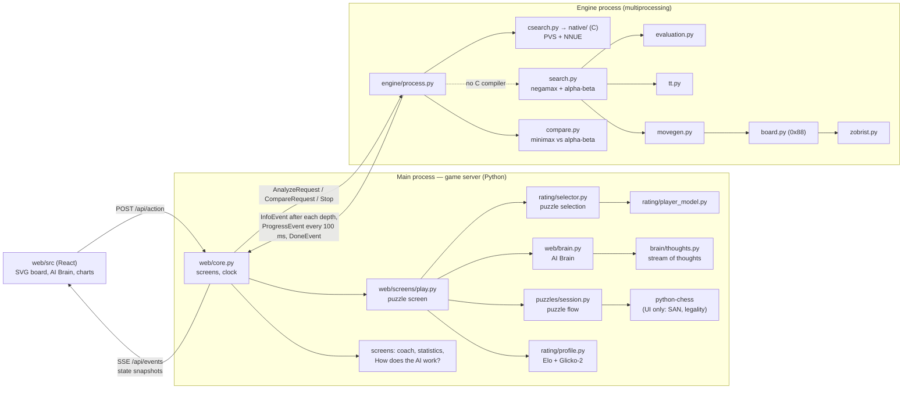
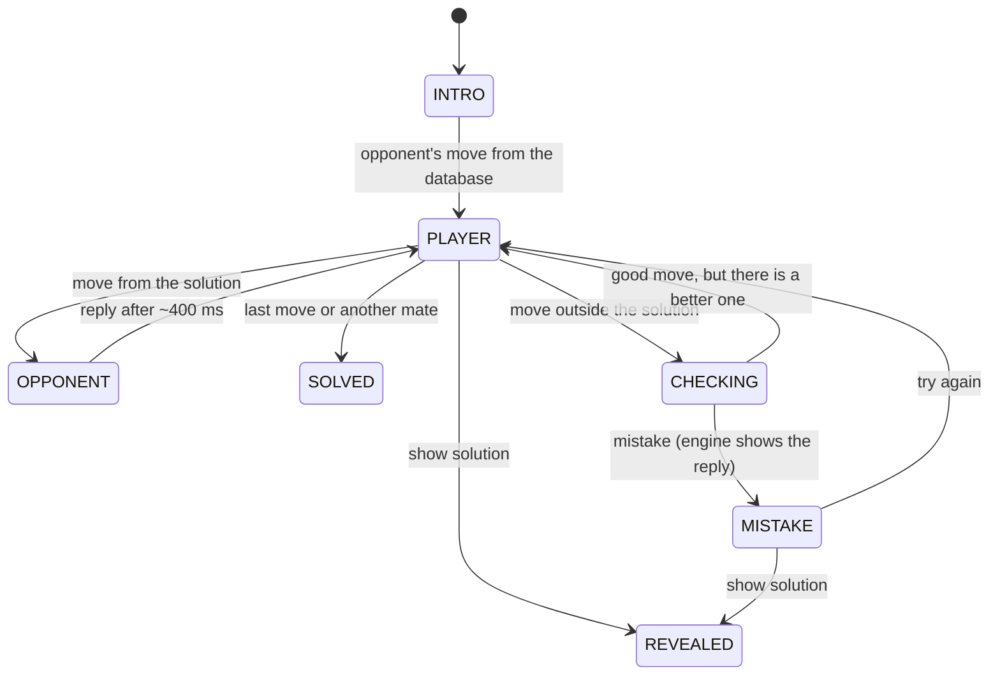

# TacticMind — chess tactics puzzles and an AI coach that thinks out loud

TacticMind is a chess tactics trainer in the style of chess.com "Puzzles". The player solves real puzzles from the
Lichess database, while next to the board the **"AI Brain"** panel shows live what the project's **own chess engine**,
written from scratch, is calculating: depth, node count, alpha-beta cutoffs, the three best moves with their lines,
a mini search tree and a "stream of thoughts" in plain language. The second AI component is an **adaptive rating**
(Glicko-2 or Elo) with a **player model** that picks the next puzzles to match the player's current level and weak spots.

The second game is a **game against the coach** (like "Play Coach" on chess.com): you play the coach at a chosen strength
(400–2900 Elo, the top being the engine at full strength), and after each of your moves it rates it (best, good, inaccuracy, mistake, blunder…),
explains what your move does and which move would have been better — and why. You can also **learn openings**: 15 lines
with an explanation of every move. After 10 calibration games the **"Your level"** option appears — the coach plays at a
strength matched to your results and adjusts it every 5 games.


Stockfish or any other ready-made engine is **not used** in the game. The game engine is written from scratch in **C**
(bitboards, alpha-beta in its PVS variant) and evaluates positions with an **NNUE neural network** trained in this project
on the engine's self-play games ([C engine and NNUE network](#c-engine-and-nnue-network)). A simpler version of the engine
in Python (0x88 board) remains as a fallback when no C compiler is available, and for the minimax vs alpha-beta demonstration.
The `python-chess` library is used only by the interface layer (SAN notation, checking the legality of the player's move).

---

## Table of contents

1. [Getting started](#getting-started)
2. [How to play](#how-to-play)
3. [Playing against the coach](#playing-against-the-coach)
4. [Architecture](#architecture)
5. [Algorithms](#algorithms)
6. [C engine and NNUE network](#c-engine-and-nnue-network)
7. [Benchmarks: minimax vs alpha-beta](#benchmarks-minimax-vs-alpha-beta)
8. [Tests](#tests)
9. [Puzzles from the Lichess database](#puzzles-from-the-lichess-database)
10. [Design decisions](#design-decisions)
11. [Work stages](#work-stages)
12. [Sources and licenses](#sources-and-licenses)

---

## Getting started

Requirements: **Python 3.11+** (tested on Python 3.14). No backend and no internet — everything runs locally.
On Linux the game window also needs WebKitGTK and the system GTK bindings for Python (Windows 10/11 and macOS already
have everything the window needs):

| System | Command |
|---|---|
| Arch / Manjaro | `sudo pacman -S --needed python-gobject webkit2gtk-4.1` |
| Debian / Ubuntu / Mint | `sudo apt install python3-gi gir1.2-webkit2-4.1` |
| Fedora | `sudo dnf install python3-gobject webkit2gtk4.1` |

```bash
python3 -m venv .venv
source .venv/bin/activate          # Windows: .venv\Scripts\activate
pip install -r requirements.txt    # python-chess, pywebview (game window), pytest
python main.py                     # or: python -m tacticmind
```

The C engine compiles itself on first launch (about 2 s) if a C compiler is installed:
`gcc` on Linux (`sudo apt install build-essential`), `clang` on macOS (`xcode-select --install`). On Windows
without a compiler the game uses the prebuilt library from `tacticmind/engine/native/prebuilt/windows-x64/`. If none of
this works, the game silently falls back to the Python engine (weaker, but it behaves the same). Manually:

```bash
python scripts/build_engine.py     # library for the game + the tmengine UCI program
```

`python main.py` starts a local game server and shows the game in its own window
([pywebview](https://pywebview.flowrl.com/) with the system's web engine: WebKitGTK on Linux, WebView2 on Windows,
WKWebView on macOS), so nothing has to be built. Closing the window ends the game.

On Linux, when a Chromium-based browser is installed (Chromium, Chrome, Brave, Edge or Vivaldi), the game opens in that
browser's app window instead: a bare window without tabs or an address bar, with its own profile in
`~/.tacticmind/window`. WebKitGTK paces animations with a 60 Hz timer when it cannot read the display's refresh rate
(common with the NVIDIA driver), and Qt WebEngine is fixed at 60 FPS too, while Chromium follows the monitor (170 FPS
on a 170 Hz screen). `TACTICMIND_BROWSER=brave` picks a browser, and `TACTICMIND_WINDOW=webview` keeps the pywebview
window. Without such a browser the game uses pywebview as described here. On Linux the
`.venv` uses the system PyGObject by itself, as long as it was created with the system Python; if anything is missing,
`python main.py` prints what to install. Under Wayland with the proprietary NVIDIA driver the game turns off the driver's
explicit sync by itself (`__NV_DISABLE_EXPLICIT_SYNC=1`): with it the window closes at once with "Error 71 (Protocol error)
dispatching to Wayland display". If the window still closes or stays blank, start the game with
`WEBKIT_DISABLE_DMABUF_RENDERER=1 python main.py` (WebKitGTK's fallback renderer: it works everywhere, but is much slower).

Tests:

```bash
python -m pytest
cd web && npm install && npm test    # interface tests (vitest)
```

Progress (rating, history, statistics, coach games and opening lessons) is saved to `~/.tacticmind/profile.json`
(a different directory can be set with the `TACTICMIND_HOME` variable), and interface settings (FPS counter, frame limit,
theme and board) to `~/.tacticmind/ui_settings.json`.

### Working on the interface

The interface code lives in `web/src` (React 19 + TypeScript + Vite). The built version goes to `tacticmind/web/static`
and is committed to the repository, so Node.js is not needed to play.

```bash
python main.py --no-window         # game server at http://127.0.0.1:8517
cd web && npm install
npm run dev                        # http://localhost:5173 — code changes show up immediately
npm run typecheck && npm test      # TypeScript (strict) and vitest tests
npm run build                      # new build into tacticmind/web/static
```

## How to play

- **Start screen**: "Tactics puzzles", "Play the coach", "Statistics", "How does the AI work?". The same places
  are in the top bar: "Puzzles", "Coach", "Statistics", "How does the AI work?".
- **Puzzle**: the opponent makes the first move (animated), then you look for the best move. The board is
  flipped to your side. You move by dragging or click-click; dots pop up on legal squares (rings close in on pieces
  you can capture), and on promotion
  a piece picker appears. The opponent's replies are played automatically after about 400 ms.
- **Feedback**: a lime ✓ or a red ✗ on the target square and the messages "Best move!" /
  "Sorry, that's not it". After a mistake the engine calculates the opponent's reply, e.g. "After Rd1? the opponent plays Qxh2#. Mate.",
  and you choose "Try again" or "Show solution".
- **Brilliant move (!!)**: if the correct move is a sacrifice (you give up a piece for at least 2 pawns of material,
  e.g. a rook for a pawn), instead of ✓ a cyan "!!" appears with a glow, sparks and the message "Brilliant move!!" —
  just like on chess.com (`puzzles/validator.py: is_sacrifice`).
- **Stepping through moves**: the ◀ ▶ buttons under the board (or the ← → keys) work throughout the puzzle —
  you can go back to the position before the opponent's move and see what happened. Stepping back is animated too: the piece
  glides back to its square, a captured piece reappears, and the sound matches the move being undone (capture,
  check, castling…). You cannot move or see a hint in an earlier position; ▶ to the end (or the opponent's next
  move) returns to the current position.
- **Puzzle modes**: the chip above the puzzle ("Rated ▾") opens the mode picker:
  - *Rated* — the default: puzzles picked for your level and weak spots,
  - *Train a theme* — only puzzles with one theme (forks, pins, mates in 2…), still at your level and still rated;
    each theme shows how many puzzles it has and your success rate in it (weak themes in orange),
  - *Review mistakes* — puzzles you failed come back, oldest first, until you solve them without a mistake or a hint;
    unrated, and when the queue is empty you go back to rated puzzles,
  - *Puzzle Rush* — 3 min, 5 min or Survival (no clock): every puzzle is a little harder (from about 600), a mistake,
    a hint or giving up is a strike, and 3 strikes end the run. Unrated; the best score of each variant is remembered
    and the summary shows the rating of every puzzle in the run.

  Switching modes in the middle of a rated puzzle asks first, because the started puzzle then counts as unsolved.
- **Buttons**: during a puzzle you see "Hint" and "Show solution" (after a mistake also "Try again");
  "Next puzzle" appears only after solving the puzzle or revealing the solution.
- **Alternative solutions**: a move other than the reference move that delivers mate solves the puzzle. A move that,
  according to the engine, is still clearly winning (evaluation > +3 and at most 0.5 pawn worse than the best) gives the message
  "Good move, but there is a better one. Try again" and is not counted as a mistake.
- **The "AI Brain" panel** has three modes:
  - *Hidden* — while solving, only the counters and the fact that the AI is calculating are visible,
  - *Hint* — highlights the piece that has to move (the rating reward is halved),
  - *Full* — after the puzzle (or after a mistake) everything is visible: the evaluation bar, arrows (best move in lime,
    second and third semi-transparent), 3 candidate lines in SAN, the stream of thoughts, the mini tree, and the AI explains the puzzle.
    Clicking a candidate line replays it on the board in preview mode.
- **Rating**: a big number at the top (e.g. "1450 ± 80") with an animated change (+12 in lime, −9 in red),
  a streak with a fire icon, the puzzle rating shown once the puzzle is over, and a "Why this puzzle?" pop-up.
- After a puzzle ends, ◀ ▶ (or ← →) step through the positions, and the engine analyses each of them.
- **Arrows and highlights (like on chess.com)**: drag with the right mouse button from square to square to
  draw an arrow (a knight move is drawn as an L), and click to highlight a square. Shift = red,
  Ctrl = blue, Alt = lime, no modifier = amber. Drawing the same arrow again removes it; a left click
  on the board or making a move clears the drawings.
- **Language**: the interface is in English by default, and Polish is available as a second language. The EN / PL switch in
  the top bar changes the whole interface, including the AI's "thoughts", explanations, theme names and the piece letters in
  notation (Q/R/B/N in English; the Polish locale uses Polish piece letters H/W/G/S). The choice is remembered.
- **Resolution and responsiveness**: the whole interface scales to the window size (from a small window up to 4K), and texts
  fit their boxes (they shrink the font or get truncated with "…" instead of overflowing).
  In a wide window the board has the panel beside it and a vertical evaluation bar; in a narrow one (like a phone) there is a
  two-row top bar, a horizontal evaluation bar above the board, the panel below it, and the whole page scrolls with the mouse wheel.
- **Icon**: the window has its own icon (a white pawn on a tile): `web/public/icon.png`
  (on Linux the window uses its built copy, `tacticmind/web/static/icon.png`).
- **Sounds (chess.com style)**: a warm wooden "thock" on a move (a piece set down on a wooden board), a sharper
  piece-on-piece click followed by the thock on a capture, a thock with a short marimba note on check, two quick thocks
  on castling, rising marimba notes on promotion and after solving a puzzle (an arpeggio with a bell for a brilliant
  move) and a soft low pair after a mistake. All of them are synthesized in code on Web Audio (`web/src/sound.ts`):
  a short contact pulse rings a bank of resonators tuned like a wooden board, a piece and a marimba bar, so there
  are no recordings under someone else's license.
- **Volume**: the top bar has a volume slider (drag it, click it or scroll the mouse wheel over it);
  the speaker icon mutes/unmutes the sound. The volume is remembered in the profile.
- **Full screen**: F11 or the ⛶ button in the top-right corner toggles full-screen mode of the window.
- **Settings** (gear in the top bar): an FPS counter in the bottom-left corner (F3 toggles it), an animation
  frame limit (60, 120, 144, 170, 240 or unlimited, as fast as the monitor refreshes), a dark or light theme and the
  board colours (green, terracotta or slate).
- **Dragging like on chess.com**: a grabbed piece jumps under the cursor at once and then chases it with a little
  inertia, leaning into the motion; the cursor turns into an open hand while you hold a piece, and the square it would
  land on gets a light frame. Letting go on the same square just selects the piece (click-click); a second click puts
  it down.
- **Look and animations**: a "chess club poster" style: a warm dark background with a dot grid (or warm paper in the
  light theme), cards and buttons with thick ink outlines and hard offset shadows, acid lime for the player and hot pink
  for the AI, the Bricolage Grotesque display font for headings, Space Grotesk for text and Space Mono for numbers
  and moves. The board is cream and green, with slim pieces of our own (`scripts/make_pieces.py`: a thin outline, a flat
  fill and a shaded right edge). A grabbed piece follows the pointer on its own compositor layer, so dragging stays smooth. Animations: smooth piece movement
  (a captured piece disappears), a popping ✓/✗ with a ripple, a board shake after a mistake, confetti after solving,
  a pulsing hint and check, a springy evaluation bar, screen cross-fades, sliding toggle indicators.

## Playing against the coach

The **"Coach"** tab. The coach is called Maks — his portrait (with several facial expressions that change during the game)
is drawn in SVG (`web/src/components/CoachAvatar.tsx`), without image files.

- **Game settings**: the coach's strength set with a slider from 400 to 2900 Elo (with a label: beginner, amateur,
  intermediate, advanced, expert, master and, at the top, full engine strength), colour (white / random / black) and a "Play" button.
- **"Your level"**: the first 10 games are calibration (a "calibration 3/10" counter). After the 10th game
  a new difficulty level unlocks — the coach plays at a strength equal to your game rating. This level
  changes **every 5 games** (after the 15th, 20th, 25th …), and the game summary tells you when the next change will happen.
- **During the game**: after each of your moves the coach shows a move-class badge on the target square and in the move
  list — !! brilliant, ! great, ★ best, ✓ excellent / good, book (from theory), ?! inaccuracy,
  ? mistake, ?? blunder — and says what the move does, or what the opponent threatens and what was better, e.g.
  "The opponent will reply 1... hxg6 and you lose your queen. Nc3 was better — it develops the knight.".
  After a **mistake or blunder** the game pauses: "Take back and fix" (an arrow shows the better move)
  or "Keep playing". The coach also comments on its own moves and warns about its threats ("Careful — I'm threatening mate!").
  The coach's face reacts to your moves (joy, worry, surprise), and while calculating it looks thoughtful.
- **Help**: "Hint" (an arrow for the best move) and "Take back move". Each use of help lowers the game result
  counted towards "Your level" by 0.1.
- **Opening name** shown live (e.g. "Sicilian Defence — Najdorf Variation"), recognized from the position, so
  it also works with transpositions.
- **Player bars** above and below the board: the coach's portrait and your icon, whose turn it is, captured pieces
  and material advantage.
- **Evaluation bar** beside the board: the engine's evaluation of the position on the board (also when stepping
  through the game). The button with the bar icon under the board shows or hides it; the choice is remembered.
- **After the game**: a summary with your and the coach's **accuracy** (%), the number of moves in each class and the level change.
  With the ◀ ▶ buttons (or by clicking a move in the list) you review the game — each move brings back the coach's comment,
  and for weaker moves an arrow shows what was better. "Rematch" starts a new game with the same settings.
- **Advantage graph and PGN**: after the game an "Advantage" graph shows White's winning chance after every move
  (as in chess.com's Game Review), with dots on your inaccuracies, mistakes, blunders and great or brilliant moves; clicking
  or dragging on the graph jumps to that move. "Copy PGN" and "Save PGN" export the game with the move classes as
  annotation symbols (!!, !, ?!, ?, ??), the engine evaluation (`[%eval]`, read by Lichess and chess.com) and the coach's
  comments; the file goes to the Downloads folder. The graph uses the analyses the coach already made during the game, so it costs no extra engine time.
- **Your games**: the "Your games" tab on the coach screen lists your recent games (result, coach strength, opening,
  accuracy, rating change). Clicking one opens it in the same review — board, badges, the coach's comments in the current
  language, the graph and PGN. The newest 100 games keep their moves in the profile (`coach/archive.py`); games saved
  before this feature only have their result.
- **Opening lessons**: 15 openings — for White the Italian Game, Ruy Lopez, Scotch Game, Queen's Gambit, London System,
  English Opening; for Black the Sicilian Defence (Najdorf), French, Caro-Kann, Scandinavian, Two
  Knights, Slav, King's Indian, Nimzo-Indian and Grünfeld. You play the main-line moves, the coach replies
  with moves from that line and **explains every move** (both sides). A move off the line is taken back, and the coach says
  what is played here and why (if your move is also theory, it says so too). Completing an opening earns stars: 1 —
  completed, 2 — without a mistake, 3 — three times without a mistake. After the lesson you can keep playing from that
  position — it then becomes a regular game, counted towards "Your level".
- On the coach screens the top bar shows your coach-game rating (separate from the puzzle rating).

## Architecture

```
main.py                     # game entry point (starts the server and the interface window)
tacticmind/
  engine/                   # OWN ENGINE
    native/                 #   C engine: bitboard.c, position.c (make/unmake + NNUE accumulator),
                            #   movegen.c (moves, SEE, perft), search.c (PVS), nnue.c, eval.c (hand-written eval),
                            #   api.c (for ctypes), uci.c (tmengine UCI program), tacticmind.nnue (network)
    native.py               #   compiling and loading the C library (ctypes)
    csearch.py              #   CSearcher — C engine with the Searcher interface; make_searcher() picks C or Python
    constants.py            #   piece codes, move encoding, 0x88 square tables
    zobrist.py              #   Zobrist hashing keys
    board.py                #   0x88 board, FEN, make/unmake, incremental hash and evaluation
    movegen.py              #   move generator, check/mate/stalemate, perft
    pst.py, evaluation.py   #   evaluation function (tapered PST, mobility, king, pawns)
    tt.py                   #   transposition table
    search.py               #   negamax + alpha-beta, ID, quiescence, MultiPV, statistics
    compare.py              #   comparison mode: minimax / alpha-beta / alpha-beta + ordering
    process.py              #   engine in a separate process + message protocol
    types.py                #   SearchInfo, EngineScore, TreeNode…
  rating/                   # elo.py, glicko2.py, player_model.py, selector.py, profile.py,
                            #   coach_profile.py (coach games, calibration, "Your level", opening stars)
  coach/                    # GAME AGAINST THE COACH: openings.py (opening book, opening names),
                            #   strength.py (playing strength by Elo), review.py (move classes, accuracy),
                            #   advice.py (coach explanations), game.py (game and lesson flow),
                            #   archive.py (saved games for the review, advantage graph, PGN export)
  puzzles/                  # loader.py, themes.py (translations), validator.py, session.py
  brain/                    # notation.py (SAN in the interface language), thoughts.py (stream of thoughts), demo.py
  i18n/                     # translations: pl.py, en.py (one dictionary per language) + plurals, number formats;
                            #   openings_pl.py / openings_en.py — opening names and explanations
  web/                      # TYPESCRIPT INTERFACE SERVER: core.py (screens → state snapshots, actions),
                            #   screens/ (puzzle, coach, statistics, "How does the AI work?"), board.py, brain.py,
                            #   server.py (HTTP + SSE on 127.0.0.1), app.py (launch), window.py (game window),
                            #   static/ (built interface — produced by `npm run build`, do not edit by hand)
  data/                     # starter_puzzles.json (50 puzzles), puzzles.json (3000 puzzles)
  assets/fonts/             # Space Grotesk, Bricolage Grotesque, Space Mono and Noto fallbacks (WOFF2 subsets)
  assets/coach.png          # coach portrait for this README
web/                        # TYPESCRIPT INTERFACE
  src/                      #   React 19: App.tsx, screens/, components/ (Board.tsx — SVG board, BrainPanel,
                            #   EvalBar, TopBar with settings, CoachAvatar…), chess.ts (FEN, animations, arrows),
                            #   ticker.ts (a single requestAnimationFrame loop with an FPS limit), effects.ts, sound.ts
  public/pieces/            #   our own pieces (SVG, drawn by scripts/make_pieces.py)
scripts/build_puzzles.py    # builds the puzzle set from the Lichess database
scripts/make_pieces.py      # draws the piece set (web/public/pieces/*.svg)
scripts/benchmark.py        # measurements for the table in the README
scripts/build_engine.py     # compiles the C engine
scripts/match.py            # engine-vs-engine matches (Elo measurement)
scripts/nnue/               # NNUE network trainer (train.c) and a description of the training cycle
tests/                      # pytest
```

Game logic and the engine are separated from the interface: `engine/`, `rating/`, `puzzles/`, `brain/` and `coach/` are pure
modules without any interface code, covered by unit tests. The interface only calls them and draws the results.

**TypeScript interface.** Python holds the game state: `tacticmind/web/core.py` runs the screens (puzzle, game
against the coach, statistics…) without drawing, and after every change sends a state snapshot (JSON) over the SSE stream
`/api/events`; moves and clicks come back as `POST /api/action`. The interface only draws: an SVG board
(sharp at any resolution and any display scaling), move animations, arrows, move badges, effects
and charts — all in a single `requestAnimationFrame` loop with the frame limit from the settings. The player's move appears
immediately (optimistically), and Python confirms or reverts it. The server listens only on `127.0.0.1`, rejects a foreign
`Host` header (DNS rebinding) and actions without the `X-TacticMind` header. `python main.py` starts
the server on a free port and opens the game window on its address (`tacticmind/web/window.py`: a Chromium app window on
Linux when one is installed, otherwise pywebview); in pywebview full screen (F11) goes through a small Python API the
window gives the page, and closing the window shuts the server down. The engine runs in a separate process behind `EngineClient` (`engine/process.py`).



**Engine protocol** (`engine/process.py`): after each completed depth the process sends an `InfoEvent` with a
`SearchInfo` object = `{ depth, score (cp or mate), pv, multi_pv, nodes, nps, cutoffs, tt_hits, time_ms, tree }`.
About every 100 ms a `ProgressEvent` arrives (live counters during a depth). The `stop` command sets
a shared `multiprocessing.Event` flag that the search checks every 1024 nodes — interruption is
immediate, and the process handles further requests without restarting.

Puzzle flow (`puzzles/session.py`):



## Algorithms

### 0x88 board representation and move generator

The board is an array of 128 squares (16 files × 8 ranks); only files 0–7 are used. Index = `rank·16 + file`.
The 0x88 trick: a square is on the board if and only if `(square & 0x88) == 0` — a single bitwise operation
detects stepping off the board. Based on this, at start-up we compute once the square lists for knights, the king
and bishop/rook rays that the generator uses. A move is a single integer
(from square, to square, promotion piece, flags: capture, en passant, castling, pawn double push).

The generator produces pseudo-legal moves (with castling, en passant and promotions to 4 pieces), and legality
is checked after making the move: if our own king is attacked, the move is undone (`make_legal_move`).
`make_move`/`unmake_move` push onto a stack everything that cannot be restored from the move (the captured piece,
castling rights, the en passant square, the 50-move counter, the hash). The generator's correctness is confirmed by **perft** —
the number of leaves of the move tree matches the reference values for 5 positions (tests in `tests/test_perft.py`).

### Minimax (negamax)

We assume both sides play perfectly: we maximize the evaluation, the opponent minimizes it. The
**negamax** formulation uses the identity `max(a, b) = −min(−a, −b)`: the evaluation of a position for the side to move is minus
the opponent's best evaluation after each of our moves. A single function is enough.

```
function negamax(position, depth):
    if depth == 0: return evaluate(position)          # from the side to move's perspective
    best = −∞
    for each legal move:
        make move
        best = max(best, −negamax(position, depth − 1))
        unmake move
    if no moves: return (in check ? −MATE + ply : 0)   # checkmate or stalemate
    return best
```

Minimax visits about `b^d` nodes (b ≈ 30–35 moves, d = depth) — at depth 5 that is tens of millions.

### Alpha-beta

Alpha-beta gives **the same result** as minimax, but skips branches that cannot change the decision.
`α` = the score the side to move is already guaranteed; `β` = the best score its opponent will allow.
When some move scores ≥ β, the opponent will not allow this position — the remaining moves are not searched
(**β cutoff**).

```
function alphabeta(position, depth, α, β, ply):
    if draw (repetition, 50 moves): return 0
    if in check: depth += 1                           # check extension
    if depth <= 0: return quiescence(position, α, β)
    probe the transposition table (may give a score or the best move right away)
    best = −∞
    for each move in order: TT/PV, MVV-LVA captures, killers, history:
        if move is illegal: skip
        make move
        score = −alphabeta(position, depth − 1, −β, −α, ply + 1)
        unmake move
        if score > best:
            best = score
            if score > α:
                α = score; store the line (PV)
                if score >= β:                        # β cutoff
                    record the move as killer/history; break the loop
    if no legal moves: return (in check ? −MATE + ply : 0)
    store in TT (exact / lower bound / upper bound)
    return best
```

With perfect move ordering alpha-beta visits about `b^(d/2)` nodes — in the same time it searches almost
twice as deep. That is why **move ordering** matters so much:

1. the move from the principal variation / transposition table (the best one from the shallower iteration),
2. captures by **MVV-LVA** (most valuable victim, least valuable attacker), queen promotions,
3. **killer moves** — two quiet moves per ply that recently caused a cutoff,
4. **history heuristic** — `depth²` points for moves (piece → square) that caused cutoffs.

Moves are picked lazily (selection sort): after a cutoff the rest of the list is skipped anyway.

### Iterative deepening

The engine searches depth 1, then 2, 3… until the time or depth limit. Shallow iterations are cheap, and their
best line orders the moves in the deeper one — this yields more cutoffs than a single search
straight at the target depth. After each completed depth the engine sends the result to the interface
(hence the live "thoughts"). A new depth is not started if more than half of the time has been used.
When a mate in `n` plies is found and the depth is ≥ `n`, the search stops (there is no shorter mate).

### Quiescence search

An evaluation in the middle of an exchange is misleading (e.g. the queen has just captured a pawn but is about to be captured) — this is the **horizon
effect**. So at the leaves we play out captures and promotions until the position is quiet:

```
function quiescence(position, α, β):
    if in check: consider all moves (so as not to miss a mate)
    else:
        stand_pat = evaluate(position)                 # the side to move may decline to capture
        if stand_pat >= β: return stand_pat
        α = max(α, stand_pat)
    for each capture/promotion (MVV-LVA):
        skip captures that cannot raise α (delta pruning)
        skip "bad captures" (a more valuable piece takes a cheaper one on a defended square)
        score = −quiescence(after the move, −β, −α)
        update α, cut off when score >= β
```

The benchmark table below (without quiescence, fixed depth) shows the horizon effect clearly: the opening evaluation
jumps between −2.1 and +1.4 depending on whether the depth ends in the middle of an exchange.

### Transposition table and Zobrist hashing

Each piece on each square, the side to move, castling rights and the en passant square are assigned a random
64-bit number (fixed seed). The position hash is the XOR of these numbers; on a move it is updated with a few XOR operations.
The transposition table (`tt.py`) stores for a hash: depth, evaluation, evaluation type (**exact**, **lower**
bound after a β cutoff, **upper** bound when no move improved α) and the best move. Mate scores are stored
relative to the current node (not the root), so that the distance to mate stays correct when read at a different depth.
The hashes are also used to detect position repetitions (draws).

### Mate scores

A mate scores `±(32000 − number of plies from the root)`, so **a faster mate is always better**, and when
defending the engine picks the longest path to mate. The interface shows this as `M3` / `−M2`.

### Evaluation function

Evaluation in centipawns (100 = a pawn):

- **material** and **piece-square tables** (PST) — separate values for the middlegame (mg) and the endgame (eg),
- **tapered eval** — score = `(mg·phase + eg·(24 − phase)) / 24`, where the phase depends on the pieces on the board
  (knight/bishop 1, rook 2, queen 4). In the middlegame the king hides, in the endgame it heads to the centre,
- **mobility** — a bonus for every available square above the typical count (separately per piece and phase),
- **king safety** — the pawn shield in front of the king, a penalty for open/half-open files, "tropism" (enemy
  pieces close to the king),
- **pawn structure** — doubled, isolated, passed (the bonus grows with every rank),
- **bishop pair**, detection of draws by insufficient material.

The board sums material and PST incrementally in `make_move`, so a leaf only pays for the terms that depend on the piece layout.
For the engine the evaluation is from the side to move's perspective (a requirement of negamax); the interface always shows it
**from White's perspective** (e.g. +1.5 or M3).

### MultiPV (3 best moves)

Instead of searching the root three times, we do it in a single pass: for each subsequent root move α = the score of the
**third** best move found so far. Moves in the top three thus get exact scores
and lines, while worse ones are quickly cut off (fail-low).

### Statistics and the mini tree

The engine keeps live counts of: depth (and maximum selective depth), nodes, nodes/s, β cutoffs, TT hits,
the share of skipped moves and time. For the last depth it records the first two levels of the tree: the root moves
with their scores (exact, or "≤" after a fail-low) and the opponent's replies — branches cut off by alpha-beta
are greyed out and struck through in the panel.

### Stream of thoughts

`brain/thoughts.py` turns successive engine results into sentences in the interface language using templates (no LLM at all),
e.g. "Depth 4: still Qxf7+ (+3.2). After Kxf7 Ng5+ I win the queen.", "I'm changing my mind! At depth 6 I see
mate in 3 after Rd8+.", "Thanks to alpha-beta I skip 84% of the branches.". The comment about winning material comes from counting
the material at the end of the PV line. A change of the best move between depths is highlighted in colour.

### Rating: Elo and Glicko-2

A puzzle is treated as an opponent with the puzzle's rating.

- Expected score: `E = 1 / (1 + 10^((R_puzzle − R_player) / 400))`
- Elo rating change: `ΔR = K · (S − E)`; K = 60 for the first 10 puzzles (calibration), then 32, after 50 puzzles 20.
- Score `S`: 1.0 — no mistake and no hint; 0.5 — with a hint; 0.0 — a wrong move (even if the player then
  finishes the puzzle) or a revealed solution. Penalty for taking very long: above 3× the player's average time,
  linearly down to −0.2 (at 6×).
- **Glicko-2** (bonus, the default system): besides the rating `r` the player has a deviation `RD` and a volatility `σ`.
  Implemented following Glickman's paper (conversion to the μ/φ scale, variance v, improvement Δ, new volatility
  via the Illinois method, new φ and μ); a test checks the example from the paper (1500/200 → 1464.06 / 151.52).
  One puzzle = one rating period; the puzzle's RD comes from the Lichess database. The interface shows "1450 ± 80"
  (± RD), and the rating chart has an uncertainty band. The system can be switched to Elo in the statistics.

### Puzzle selection and the player model

`rating/selector.py`:

- **flow zone** — we aim for about a 65% chance: puzzle rating ≈ `R_player − 100` (since E(−100) ≈ 0.64)
  with a random spread of ±75,
- the **player model** (`player_model.py`) tracks the success rate in each theme (forks, pins, mates…),
  with Bayesian smoothing (one failed puzzle does not turn a theme into a weak spot); about **30%** of puzzles come
  from the weakest themes,
- **frustration guard** — after 3 failures in a row a clearly easier puzzle (≈ R − 300); after 5 successes
  in a row a **bonus puzzle** (≈ R + 200),
- puzzles do not repeat, and themes from the last 3 puzzles get a penalty (variety),
- every decision has a justification in the **"Why this puzzle?"** pop-up, e.g. "Puzzle rating about 1380, aiming
  for a 65% chance (flow zone). Your weak spot: pin (41%)."
- **theme training** uses the same rules on the puzzles of one theme; the **review queue** (`PlayerProfile.review`, at most
  200 puzzles) gets every failed puzzle and loses it once it is solved cleanly (older profiles rebuild it from the history);
  **Puzzle Rush** ignores the rating: puzzle *n* is drawn from the 6 unused puzzles closest to `600 + 55·n`.

### Coach: playing strength based on Elo

`coach/strength.py`. The coach uses the same engine but plays weaker in three ways:

| Elo | Depth | Time per move | Candidates (MultiPV) | Temperature T | Random move |
|---|---|---|---|---|---|
| 400 | 1 | 0.4 s | 8 | 305 cp | 25% |
| 800 | 2 | 1.0 s | 6 | 174 cp | 14% |
| 1200 | 3 | 1.6 s | 5 | 80 cp | 6% |
| 1600 | 4 | 2.2 s | 4 | 24 cp | 1.6% |
| 2000 | 5 | 2.8 s | 2 | 5 cp | 0% |
| 2300 | 8 | 2.9 s | 1 | — | 0% |
| 2600 | 12 | 3.1 s | 1 | — | 0% |
| 2900 | full (time limit) | 3.2 s | 1 | — | 0% |

From the candidates the coach samples a move with probability `p(move) ~ exp((score − best_score) / T)`
(softmax with temperature T): with a large T a move half a pawn worse is almost as likely as the best one,
with a small T the coach almost always plays the best move. A "random move" is a completely random legal move, like
a beginner's blunder. In the opening the coach plays from the opening book (randomly, weighted by how many lines contain the move).
Above 2000 the coach always plays the engine's best move and only searches deeper with every step (2100 = depth 6 …
2500 = depth 10, then two plies a step); at 2900 it is the engine at full strength, which scored about 2890 against
limited-strength Stockfish (see "Strength measurements"), at a faster time control than the coach's 3 s per move.
The coach's Elo is **approximate** — exact calibration would require thousands of games against players with known ratings.

### Move classification and accuracy

`coach/review.py`. While the player is thinking, the engine analyses the position in the background (MultiPV 3, up to 1.6 s). If the player's move is
among the top three, its score is already known; if not, the engine also searches the position after the move. The score is converted
to a **win chance** (the Lichess formula): `W(cp) = 50 + 50 · (2 / (1 + e^(−0.00368208 · cp)) − 1)` — 0 cp is 50%,
+3 pawns about 75%, mate 100%. The move class depends on how many percentage points the win chance **dropped**
compared to the best move: up to 2 — excellent, up to 5 — good, up to 10 — inaccuracy, up to 20 — mistake, above that —
blunder. The engine's best move is "best", and if the second move was worse by ≥ 15 points — "great" (the only
good move; does not apply to obvious captures: a recapture or taking a piece left hanging). "Brilliant" is the engine's
move (or within 1 point of it) that really sacrifices a piece, in a position that was not already winning. A sacrifice is
measured against the safest move in the position: material that every move loses (a trapped piece, two pieces attacked
at once) is not a sacrifice. Thanks to the win-chance scale, the same half-pawn mistake weighs more in an equal
game than at a +8 advantage.

**Accuracy** of a move: `103.1668 · e^(−0.04354 · drop) − 3.1669` (%, as on Lichess). Game accuracy is also Lichess's:
the average of the mean weighted by how sharp the game was around each move and the **harmonic** mean, so a few blunders
among many easy moves pull it down instead of disappearing in the average.
The coach's moves are rated the same way, so the summary shows the accuracy of both sides.

### Coach explanations

`coach/advice.py` — no language model, only rules and engine results:

- **what the move does**: capture, check, castling, promotion, attack on a piece more valuable than the attacker or an undefended one
  (two at once = a fork), moving a piece out of attack, defending a hanging piece, developing a minor piece, a pawn in the centre,
  a rook on an open file,
- **what the opponent threatens**: the engine's line after the player's move — mate ("After this move the opponent mates: 1. Qxf7#")
  or loss of material, counted to the end of the exchange and cut at the move that actually wins material,
- **what was better**: the best move and its line — mate, material gain or the move's features ("develops the knight"),
- **the coach's threats** after its move: mate in one (checked with a "null move") or a hanging piece of the player's.

Comments are stored as data (translation key + parameters), and the text is produced at draw time, so switching
the language mid-game immediately translates earlier comments as well.

### Calibration and "Your level"

`rating/coach_profile.py`. Each game against the coach is one Glicko-2 period: the opponent's rating equals the coach's
Elo with RD = 80 (because that Elo is approximate), the score `S` = 1 / 0.5 / 0 minus 0.1 for each hint and take-back.
After **10 games** "Your level" = the rating rounded to 25 (within 400–2000); after that it is recalculated
**every 5 games**, not after each one — the opponent stays stable, and progress feels like moving up a rank.
Abandoning a game after at least 5 moves counts as resigning (after confirmation); opening lessons count towards
the level only when you keep playing after the lesson and the game ends.

## C engine and NNUE network

The game engine (`tacticmind/engine/native/`) is the same idea as the Python version — negamax with alpha-beta, iterative
deepening, quiescence, a transposition table, MultiPV — but written in C and extended with techniques that only pay off
at millions of nodes per second. The game loads it as a library via `ctypes` (`engine/native.py`),
and `engine/csearch.py` gives it exactly the same interface as the Python `Searcher`: after each depth it produces
the same `SearchInfo` (MultiPV, statistics, mini tree), so the "AI Brain" panel, the coach and puzzle evaluation work unchanged.

**Board and moves.** Bitboards (a 64-bit mask for each piece type), bishop and rook attacks from "magic"
tables (magic numbers found by random search and hard-coded), legality checked without making the move (whether after the move
anything attacks the king). Perft matches the reference values, e.g. Kiwipete at depth 5 = 193 690 690.

**Search** (`search.c`):

- **PVS** — the first move is searched with a full window, the rest with a "zero window" (is it better than α?); a full
  re-search only when a move surprises. With good move ordering this means several times fewer nodes,
- an **aspiration window** at the root (score close to the previous depth),
- **null move pruning** — if the position is ≥ β even after handing the move to the opponent, the branch will certainly cut off,
- **late move reductions** — late, quiet moves are searched shallower (the reduction grows with depth and move number),
- **reverse futility, futility and late move pruning, razoring** — in shallow nodes we skip moves with no chance of
  improving α,
- **SEE** (static exchange evaluation) — pruning losing exchanges and ordering them,
- **singular extensions** — a transposition-table move clearly better than the rest is searched deeper,
- ordering: TT move, good captures (MVV-LVA + SEE), killers, counter-move, history and continuation history.

**NNUE** (`nnue.c`, `position.c`). The evaluation is a small neural network:

```
768 features (colour × piece × square) from the side to move ──► 256 neurons ─┐
768 features from the opponent's side (same weights)          ──► 256 neurons ─┴► SCReLU ─► 512 → 1
                                                                       (8 output layers — by piece count)
```

The output layer is chosen by the number of pieces on the board (8 "buckets" from endgame to opening): the same
features mean something different in the endgame than in the opening, and the cost is zero — only one layer is computed anyway.

The NNUE trick: the first layer (the accumulator) is a sum of weight columns for the pieces on the board, and a move changes only 2–4 pieces.
Instead of 768 × 256 multiplications, each move adds and subtracts 2–4 columns of 256 numbers. The weights are
quantized to integers (int16), so evaluation costs less than the hand-written evaluation function — the engine with the network
searches 0.7–1.7 M nodes/s on a single core (depending on the CPU), about 20–30 times more than the Python engine.

**Where does the network come from?** It is trained entirely in this project (`scripts/nnue/`), with no third-party networks and no evaluations from other engines:

1. the engine with the hand-written evaluation plays itself (8–9 random plies at the start, about 5000 nodes per move);
   quiet positions are saved with the evaluation from the search,
2. a trainer in C (`train.c`, Adam, OpenMP) teaches the network to predict `sigmoid(eval / 400)`,
3. the engine with the new network plays itself again — its evaluations are better, so the next network is too.

### Strength measurements

All matches: `scripts/match.py`, 30 openings played with both colours, one thread per engine,
Elo with a 95% confidence interval.

**Successive networks** (each against the previous one, 200 games, 2 s + 0.02 s per game):

| Network | Training data | Result | Elo |
|---|---|---:|---:|
| 1 | 2.2 M positions from games with the hand-written evaluation | 78 : 22 vs the hand-written evaluation (100 games) | +220 ± 63 |
| 2 | 12 M (+ network 1 games) | 150.5 : 49.5 | +193 ± 40 |
| 3 | 20 M (+ network 2 games) | 121.5 : 78.5 | +76 ± 39 |
| 3 with 512 neurons | the same 20 M | 97 : 103 vs network 3 | −10 ± 40 (more accurate, but 2× slower) |
| 3 with buckets | the same 20 M | 104.5 : 95.5 vs network 3 | +16 ± 37 |
| **4 (in the game)** | **27.3 M** (+ network 3 games), buckets | 108.5 : 91.5 vs network 3 | +30 ± 41 |

**Against Stockfish 16 with limited strength** (`UCI_LimitStrength`, `UCI_Elo`; 100 games per level,
10 s + 0.1 s per game):

| Stockfish `UCI_Elo` | Wins / draws / losses | Score | Elo difference |
|---:|:---:|---:|---:|
| 2400 | 90 / 5 / 5 | 92.5% | +436 ± 136 |
| 2700 | 70 / 12 / 18 | 76% | +200 ± 75 |
| 3000 | 23 / 24 / 53 | 35% | −108 ± 62 |

Best-fitting Elo (maximum likelihood over all 300 games): **about 2890** (95%: 2840–2940)
on Stockfish's `UCI_Elo` scale, which is calibrated to the CCRL 40/4 list. This is an approximation: Stockfish's
calibration refers to a slower time control, while our matches were played faster.

**Against the old Python engine** (300 ms per move): 20 : 0.

To run it yourself (requires `pip install chess` and Stockfish):

```bash
python scripts/build_engine.py
python scripts/match.py --a tacticmind/engine/native/build/tmengine --b stockfish \
    --b-option UCI_LimitStrength=true --b-option UCI_Elo=2700 --tc 10+0.1 --games 100 --concurrency 4
```

## Benchmarks: minimax vs alpha-beta

Same position, same depth and same evaluation function (no quiescence and no transposition table),
so all three variants return an identical result — only the number of visited nodes differs.
Measured with `python scripts/benchmark.py` (CPython 3.14, one core). Minimax at depth 5 in the opening
was skipped — an estimated 28.6 M nodes (a dozen or so minutes in Python).

**Italian Game (middlegame)** — `r1bqkbnr/pppp1ppp/2n5/4p3/2B1P3/5N2/PPPP1PPP/RNBQK2R b KQkq - 3 3` (31 legal moves)

| Depth | Minimax | Alpha-beta | Alpha-beta + ordering | Alpha-beta savings | Savings with ordering | Eval |
|---:|---:|---:|---:|---:|---:|:---:|
| 1 | 32 (0.00 s) | 32 (0.00 s) | 32 (0.00 s) | 0.0% | 0.0% | −0.2 |
| 2 | 1 048 (0.04 s) | 660 (0.02 s) | 285 (0.01 s) | 37.0% | 72.8% | +1.3 |
| 3 | 32 072 (1.04 s) | 2 762 (0.09 s) | 2 076 (0.07 s) | 91.4% | 93.5% | −2.1 |
| 4 | 1 040 115 (33.24 s) | 60 313 (1.86 s) | 15 488 (0.48 s) | 94.2% | 98.5% | +1.4 |
| 5 | — (about 28.6 M) | 792 174 (24.84 s) | 73 121 (2.23 s) | — | 90.8% relative to alpha-beta | −1.8 |

**Endgame (position 3 from the Chess Programming Wiki)** — `8/2p5/3p4/KP5r/1R3p1k/8/4P1P1/8 w - - 0 1` (14 legal moves)

| Depth | Minimax | Alpha-beta | Alpha-beta + ordering | Alpha-beta savings | Savings with ordering | Eval |
|---:|---:|---:|---:|---:|---:|:---:|
| 1 | 15 (0.00 s) | 15 (0.00 s) | 15 (0.00 s) | 0.0% | 0.0% | +1.2 |
| 2 | 206 (0.00 s) | 131 (0.00 s) | 30 (0.00 s) | 36.4% | 85.4% | +0.9 |
| 3 | 3 018 (0.05 s) | 503 (0.01 s) | 394 (0.01 s) | 83.3% | 86.9% | +1.5 |
| 4 | 46 256 (0.71 s) | 1 733 (0.03 s) | 1 047 (0.02 s) | 96.3% | 97.7% | −0.1 |
| 5 | 720 880 (11.13 s) | 32 498 (0.49 s) | 6 946 (0.11 s) | 95.5% | 99.0% | +1.8 |

Conclusions:

- at depth 1 there are no cutoffs (the leaves have no siblings to cut), from depth 3 alpha-beta skips > 80% of nodes,
- move ordering brings alpha-beta close to the ideal `b^(d/2)`: at depth 5 in the opening 73 k instead of 792 k nodes,
- the jumping evaluations (−2.1 / +1.4 / −1.8) are the horizon effect at a fixed depth — which is why the actual game engine
  uses quiescence search.

The full engine (with iterative deepening, TT and quiescence) searches about 25–60 k nodes/s in Python; in a typical
puzzle it reaches depth 6–9 in a few seconds, finds mates in 3 in about 0.1 s (depth 3 with the check
extension) and confirms them within 2 s. The same comparison can be run interactively on the "How does the AI work?" page.

## Tests

`python -m pytest` — 181 tests, including:

| File | What it checks |
|---|---|
| `test_perft.py` | perft from the starting position (1–4: 20, 400, 8 902, 197 281), Kiwipete (1–3: 48, 2 039, 97 862), position 3 (1–4: 14, 191, 2 812, 43 238) and positions 4 and 5 from CPW; FEN round-trip and incremental hash/evaluation consistency |
| `test_search.py` | mates in 1, 2 and 3 (classic positions and ones from the Lichess database, also for Black), faster mate, stalemate/mate at the root, MultiPV, statistics, tree, interruption, minimax = alpha-beta with fewer nodes |
| `test_native.py` | C engine: perft (5 positions), mates in 1–3, stalemate/mate at the root, MultiPV, statistics and mini tree, interruption and live counters, NNUE evaluation symmetry, bundled network, C engine selection, mate on the hundredth ply, impossible en passant capture in a FEN |
| `test_engine_process.py` | engine process: `info` after each depth, interruption by a new request, comparison mode |
| `test_rating.py` | Elo E and ΔR for sample values, K during calibration, the Glicko-2 example from the paper, score S and the time penalty, profile and saving |
| `test_selector.py` | the selector hits the target rating range, an easier puzzle after 3 failures, a bonus after 5 successes, ~30% weak themes, no repeats, variety |
| `test_puzzles.py` | Lichess data (every move legal in our generator and in python-chess), puzzle flow, alternative mate, "good move, but there is a better one", Polish-locale notation, stream of thoughts |
| `test_coach.py` | every opening line legal and explained in both languages, opening names and transpositions, opening book, coach strength grows with Elo up to the full engine (a strong coach plays the best moves, a weak one samples), win chance and accuracy, move-class thresholds, "great" and "brilliant", explanations (hanging piece, missed and allowed mate, forks, coach threats), lesson flow and take-backs, game result and the help penalty, 10-game calibration and a level change every 5, profile saving |
| `test_i18n.py` | every language has the full key set and the same `{…}` fields, plurals (Polish: 1/2–4/5+), number formats, piece letters |
| `test_web.py` | TypeScript interface server: settings (validation and saving), navigation and screen snapshots, solving a puzzle and playing a coach game through actions (with the evaluation bar), promotion and legal moves in the snapshot, page/texts/state over HTTP, SSE stream, rejecting foreign requests (Host, missing header, bad JSON, path traversal), the game window with a stand-in for pywebview (address, icon, full screen, closing) and for a Chromium browser (app window, own profile, a second game gets a spare profile), the message when the window cannot open and the NVIDIA + Wayland explicit sync switch |
| `test_training.py` | puzzle modes: theme training draws only that theme, the review queue (order, clean solve removes, limit, missing puzzles, rebuilt from an old profile), Puzzle Rush gets harder without repeats and keeps the best score; on the puzzle screen: switching asks first, review is unrated, a whole Rush run (solve, 3 strikes, summary, again, back) and the clock running out |
| `test_archive.py` | saved coach games: comments and moves survive JSON (and still follow the language), damaged moves are rejected, the advantage graph, PGN export (result, NAGs, `[%eval]`), only the newest 100 games keep their moves, old profiles load; opening a saved game from the list, jumping on the graph, saving the PGN file |

The TypeScript interface has its own tests (`cd web && npm test`, vitest): FEN, trial moves (castling, en passant,
promotion), transition animations between positions, arrows, the evaluation bar, translations and plurals, and the
synthesized sounds (all finite and audible, the move sound short and dry).

The code is also checked with `ruff` and `mypy` (types on all functions, no `type: ignore`
in the game code):

```bash
pip install -r requirements-dev.txt
ruff check .
mypy tacticmind scripts main.py --disallow-untyped-defs
```

GitHub Actions (`.github/workflows/ci.yml`) runs all of this on every pull request and push to `main`: ruff, mypy and
pytest on Python 3.11 and 3.14 (the C engine is built with the runner's gcc), and for the interface vitest, the build and a
check that the committed `tacticmind/web/static` matches `web/src`.

## Puzzles from the Lichess database

Database: <https://database.lichess.org/lichess_db_puzzle.csv.zst> (license **CC0**). Columns:
`PuzzleId,FEN,Moves,Rating,RatingDeviation,Popularity,NbPlays,Themes,GameUrl,OpeningTags`.

```bash
# download the database (about 300 MB), then:
python scripts/build_puzzles.py lichess_db_puzzle.csv.zst                 # 3000 puzzles → tacticmind/data/puzzles.json
python scripts/build_puzzles.py lichess_db_puzzle.csv.zst --count 50 --out tacticmind/data/starter_puzzles.json
```

The script takes puzzles with `Popularity > 80` and `NbPlays > 500` rated 600–2800, splits them into 100-point buckets,
samples the same number of puzzles from each bucket (reservoir sampling with a fixed seed), preferring rare themes,
and checks that all moves are legal. It reads the `.zst` file with the `compression.zstd` module from Python 3.14
(on older Python just decompress it first: `unzstd`).

The repository contains both files: the **starter set** (50 real puzzles, ratings 649–2784, over 50 themes)
and the **full set** of 3000 puzzles. The game uses the full set, and falls back to the starter set when it is missing.

Note on the Lichess format: `FEN` is the position **before** the opponent's move; the first move in `Moves` is played by the opponent,
and the player plays the side to move after it (the board flips to that side).

## Design decisions

1. **Game logic in Python, drawing in TypeScript.** The original specification (PROMPT.md) assumed a pure web stack.
   The engine, rating, puzzles and coach are in Python (and C), and the browser only draws the state it receives:
   `react-chessboard` → a custom SVG board (`web/src/components/Board.tsx`: dragging, click-click, dots, promotion,
   animations, arrows); `chess.js` → `python-chess` (interface layer only); Web Worker → a separate `multiprocessing`
   process; Recharts → custom SVG charts (`Charts.tsx`); localStorage → a JSON file in the home directory;
   TypeScript strict on the interface and type annotations + mypy (`--disallow-untyped-defs`) on the Python side.
   The first interface was written in pygame; it was removed once the TypeScript one covered everything.
2. **0x88 + legality via a king check.** Simpler and more reliable than detecting pins; confirmed by perft.
3. **Incremental hash and evaluation** (material + PST) in `make_move` — in pure Python this is the biggest saving
   at the leaves.
4. **A process instead of a thread** for the engine: Python threads share the GIL and would make animations stutter; a separate process runs
   on another core. The "spawn" start method works the same on Linux, Windows and macOS.
5. **Interrupting the search**: a `multiprocessing.Event` flag checked every 1024 nodes + detection of a new request
   in the queue. Interrupting mid-tree unmakes all moves made, and the result of the last complete depth is kept.
6. **MultiPV in a single pass** (α = score of the 3rd best move) instead of searching the root three times.
7. **Python engine without null-move pruning and LMR** — this version is meant to be readable and serves to explain the algorithm.
   The C engine uses them, because master-level play is impossible without them; null move is disabled when the side
   to move has only pawns (where zugzwang is most common).
8. **Glicko-2 as the default system** (a bonus from the specification), with the option to switch to Elo in the statistics.
   Both ratings are always computed, so switching loses no data. Minimum RD = 50 (without it, after hundreds
   of puzzles the rating would almost stop changing). "± RD" is one standard deviation.
9. **The puzzle result is decided once**: on solving, on the first mistake or on revealing the solution (as on
   chess.com). After a mistake you can finish the puzzle, but the rating no longer changes; the panel switches to
   Full mode so the AI can explain what went wrong.
10. **Full mode while solving** gives away the solution, so it requires confirmation and counts the puzzle as
    unsolved. Moving on to the next puzzle is possible only once the current one is settled.
11. **"Good move, but there is a better one"**: if the player's move is among the 3 MultiPV lines, we use its score from the
    same depth as the best move; otherwise the engine searches the position after the move separately (1.6 s). The same
    analysis provides the opponent's reply shown after a mistake.
12. **Puzzle rating hidden until the end** (as on chess.com); the "Why this puzzle?" pop-up gives the target
    rating ("about 1380"), and the exact one is shown once the puzzle is over.
13. **Time penalty** computed from the average time of the last 20 solved puzzles (at least 3), linearly from
    3× to 6× the average (max. −0.2).
14. **Our own SVG pieces and sounds synthesized in code** — in the chess.com style, but drawn and tuned here rather than
    copied: the pieces come from a script (`scripts/make_pieces.py`: slim silhouettes, a thin outline, a flat fill
    with a shaded right edge), and the sounds from Web Audio (`web/src/sound.ts`), so there are no files under someone else's license. The volume slider uses a quadratic curve (volume = value²), because the ear perceives loudness
    logarithmically — so half the slider is noticeably quieter, not almost as loud.
15. **Notation in the interface language** (in English K, Q, R, B, N; in the Polish locale K, H, W, G, S) in the panel and messages;
    the engine and the protocol use UCI.
16. **Responsiveness and scaling**: the layout uses CSS container queries — a wide layout (panel beside the board) or a
    narrow, phone-like one (panel below the board, horizontal evaluation bar, scrolling page) — and everything is SVG/CSS,
    so it stays sharp at any resolution and display scaling.
17. **Two puzzle sets in the repository**: the starter set required by the specification and the full set of
    3000 puzzles generated by the script, so puzzle selection has plenty to choose from without downloading the database.
18. **A look of its own instead of a generic dark app**: neo-brutalist "club poster" cards (ink outlines, hard shadows,
    stickers), lime for the player and pink for the AI, a dark and a light theme and three boards, switched with CSS
    variables (`data-theme` / `data-board` on the page). Fonts are WOFF2 subsets (Latin with Polish letters) of Space
    Grotesk, Bricolage Grotesque and Space Mono, with Noto Sans as a fallback for Greek, arrows and symbols.
19. **Translations as dictionaries** (`tacticmind/i18n/`): each language is one file of keys; a missing key falls
    back to English (the default language). On-screen game messages are stored as functions returning text, and the stream of thoughts is
    rebuilt from the stored engine results — so switching the language takes effect immediately, even mid-puzzle.
    To add a language, copy `en.py`, translate the values and register the code in `i18n/__init__.py`.
20. **Player arrows** work like on chess.com/lichess (right button, colours with Shift/Ctrl/Alt, an L for the knight)
    and disappear after a move so they are not confused with the engine's arrows.
21. **The coach in the same application** (the "Coach" tab), not a separate program: it uses the same engine,
    profile, sounds, languages and look. It has a separate rating (coach games) so that puzzle and game results
    do not mix.
22. **Coach strength via depth + softmax sampling + blunders** instead of, e.g., artificially degrading the evaluation function:
    a weaker coach plays "human" weaker moves (close to the best ones), not strange moves nobody would play.
23. **Rating moves on a win-chance scale**, not in centipawns — the same drop in evaluation means something different
    in an equal and in a winning position. To rate the player's moves the coach uses a separate, more accurate analysis than for its own
    play, so even a weak coach still rates the player's moves well.
24. **"Your level" changes every 5 games** (after 10 calibration games), as intended: the opponent is
    stable and does not "run away" after a single win. The coach's help (hints, take-backs) lowers the result counted towards the level,
    so that the level does not rise thanks to taking back mistakes.
25. **A custom, hand-made opening book** (15 lines of 12–16 plies) instead of downloading a ready-made database:
    every move has an explanation in English and in Polish, and opening names are recognized from the position (EPD).

## Work stages

1. **Skeleton, board, puzzles** — the `tacticmind` package, a pygame window, a custom board, the starter set
   and the puzzle flow (`puzzles/session.py`).
2. **Engine: board and generator** — 0x88, FEN, make/unmake, Zobrist, perft (all reference values match).
3. **Search** — evaluation, negamax + alpha-beta, ID, quiescence, TT, MultiPV, the engine process, mate tests.
4. **The "AI Brain" panel** — evaluation bar, arrows, live counters, candidate lines, stream of thoughts, tree, visibility modes.
5. **Rating and puzzle selection** — Elo, Glicko-2, player model, selector, the "Why this puzzle?" pop-up.
6. **Statistics, start screen, "How does the AI work?"** — charts, live comparison, a step-by-step alpha-beta
   demonstration, sounds, animations, responsiveness.
7. **The `build_puzzles.py` script and the README** — 3000 puzzles from the Lichess database, `scripts/benchmark.py` measurements.
8. **Second version of the interface** — a custom look (instead of one resembling chess.com), anti-aliased graphics, scaling
   to the window resolution and fitting texts, new animations, English (a translation system ready for more
   languages), arrows and highlights drawn with the right mouse button.
9. **Game against the coach** — an opening book with explanations, Elo-dependent playing strength, move classes and accuracy, coach
   explanations, calibration and "Your level" every 5 games, a coach portrait with facial expressions, the "Coach" and game screens, tests.
10. **C engine with NNUE** — bitboards, PVS with pruning, an NNUE network with incremental updates, a custom data generator
    and network trainer, four training rounds (27 M positions), about 2890 Elo on the scale of limited-strength Stockfish.
11. **TypeScript interface and Tauri 2 window** — a sharp interface (SVG instead of pygame pixels) in React + TypeScript,
    game logic still in Python behind a local server (HTTP + SSE), settings with an FPS counter and a frame limit,
    an application window in Tauri 2 that starts Python by itself.
12. **Game review and a lighter repository** — saved coach games with the advantage graph and PGN export; the old pygame
    interface removed (about 7 000 lines and the pygame-ce dependency) and the fonts reduced to WOFF2 subsets.
13. **Puzzle modes and CI** — theme training, review of failed puzzles and Puzzle Rush (3 min, 5 min, Survival); tests
    on GitHub Actions for every pull request.
14. **One game window** — `python main.py` opens the game in a native window (pywebview, the system's web engine) instead
    of a Chrome window or the separate Tauri app; Rust and the Tauri build (about 1 GB of build files) are no longer needed.
15. **A new look, pieces and sounds** — the "club poster" design with a light theme and three boards, our own
    chess.com-style pieces and a drier move sound; on Linux the game opens in a Chromium app window, so animations
    follow the monitor's refresh rate instead of WebKitGTK's 60 Hz timer.
16. **Slimmer pieces, wooden sounds, a stronger coach** — neo-style pieces, resonator-based wooden and marimba sounds,
    chess.com-style dragging (the piece jumps to the cursor and follows it with inertia), popping move dots, a coach
    up to the engine's full strength (2900) and an evaluation bar in the coach game that can be hidden.

## Sources and licenses

- C engine and NNUE network: code and weights written and trained in this project. Descriptions of the techniques (magic bitboards,
  PVS, null move, LMR, SEE, NNUE) — [Chess Programming Wiki](https://www.chessprogramming.org/). Stockfish
  (GPL-3.0) is used only as an opponent in `scripts/match.py` to measure strength; it is not part of the game
  and does not provide evaluations for training the network.
- Puzzles: [Lichess puzzle database](https://database.lichess.org/#puzzles), license **CC0** (public domain).
  Each puzzle has a link to its source game (`url`).
- Perft values: [Chess Programming Wiki — Perft Results](https://www.chessprogramming.org/Perft_Results).
- Glicko-2: M. E. Glickman, *Example of the Glicko-2 system* (glicko.net).
- Piece-square tables based on the "Simplified Evaluation Function" (T. Michniewski, Chess Programming Wiki),
  extended with endgame values.
- Fonts: Space Grotesk, Space Mono and Bricolage Grotesque (SIL Open Font License 1.1, files from Fontsource) and Noto
  (Google) — licenses in `tacticmind/assets/fonts/`.
- Pieces: drawn for this project by `scripts/make_pieces.py`.
- Libraries: [python-chess](https://python-chess.readthedocs.io/) (GPL-3.0, interface layer only),
  [React](https://react.dev/) and [Vite](https://vite.dev/) (MIT), [pywebview](https://pywebview.flowrl.com/) (BSD-3-Clause).
