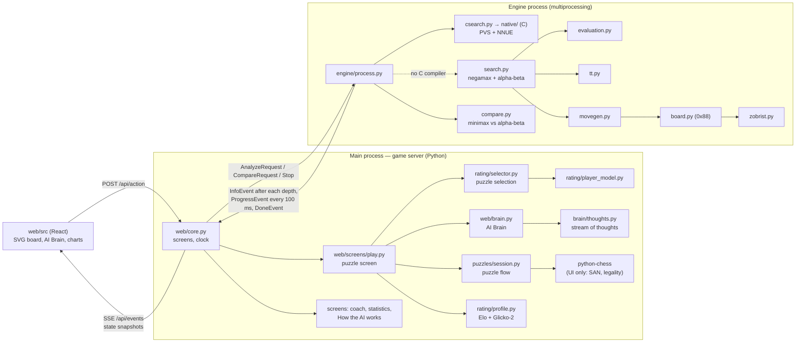
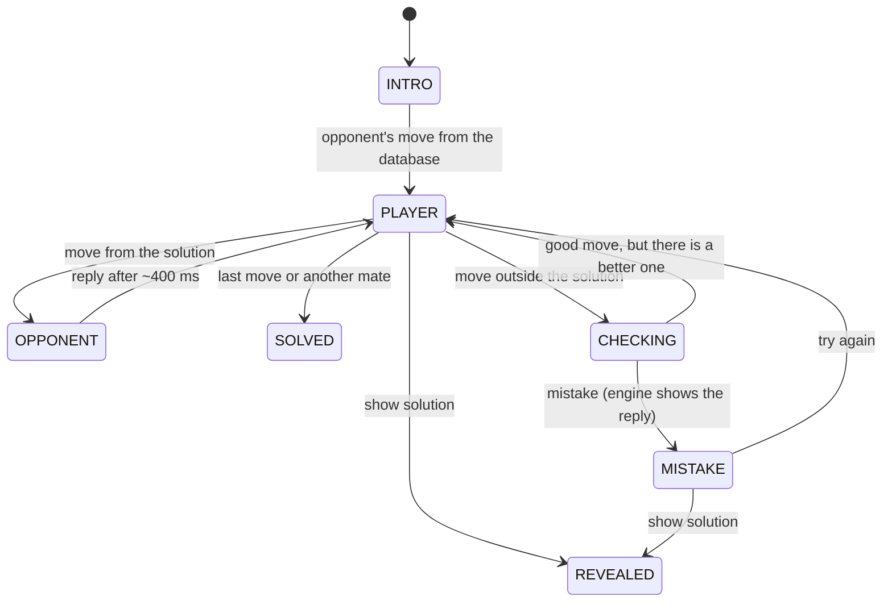

# Architecture


```
main.py                     # game entry point (starts the server and the interface window)
tacticmind/
  engine/                   # OWN ENGINE
    native/                 #   C engine: bitboard.c, position.c (make/unmake + NNUE accumulator),
                            #   movegen.c (moves, SEE, perft), search.c (PVS), nnue.c, eval.c (hand-written eval),
                            #   api.c (for ctypes), uci.c (tmengine UCI program), tacticmind.nnue (network),
                            #   prebuilt/windows-x64/tmengine.dll (ready library for Windows without a compiler)
    native.py               #   compiling and loading the C library (ctypes)
    csearch.py              #   CSearcher — C engine with the Searcher interface; make_searcher() picks C or Python
    constants.py            #   piece codes, move encoding, 0x88 square tables
    zobrist.py              #   Zobrist hashing keys
    board.py                #   0x88 board, FEN, make/unmake, incremental hash and evaluation
    movegen.py              #   move generator, check/mate/stalemate, perft
    pst.py, evaluation.py   #   evaluation function (tapered PST, mobility, king, pawns)
    tt.py                   #   transposition table
    search.py               #   negamax + alpha-beta, ID, quiescence, MultiPV, statistics
    compare.py              #   comparison mode: minimax / alpha-beta / alpha-beta + ordering
    process.py              #   engine in a separate process + message protocol
    types.py                #   SearchInfo, EngineScore, TreeNode…
  rating/                   # elo.py, glicko2.py, player_model.py, selector.py, profile.py,
                            #   coach_profile.py (coach games, calibration, "Your level", opening stars)
  coach/                    # GAME AGAINST THE COACH: openings.py (opening book, opening names),
                            #   strength.py (playing strength by Elo), review.py (move classes, accuracy),
                            #   advice.py (coach explanations), game.py (game and lesson flow),
                            #   archive.py (saved games for the review, advantage graph, PGN export)
  puzzles/                  # loader.py, themes.py (translations), validator.py, session.py
  brain/                    # notation.py (SAN in the interface language), thoughts.py (stream of thoughts), demo.py
  i18n/                     # translations: pl.py, en.py (one dictionary per language) + plurals, number formats;
                            #   openings_pl.py / openings_en.py — opening names and explanations
  web/                      # TYPESCRIPT INTERFACE SERVER: core.py (screens → state snapshots, actions),
                            #   screens/ (puzzle, coach, statistics, "How the AI works"), board.py, brain.py,
                            #   server.py (HTTP + SSE on 127.0.0.1), app.py (launch), window.py (game window),
                            #   static/ (built interface — produced by `npm run build`, do not edit by hand)
  data/                     # starter_puzzles.json (50 puzzles), puzzles.json (3000 puzzles)
  assets/fonts/             # Space Grotesk, Bricolage Grotesque, Space Mono and Noto fallbacks (WOFF2 subsets)
  assets/coach.png          # coach portrait (shown in the README)
web/                        # TYPESCRIPT INTERFACE
  src/                      #   React 19: App.tsx, screens/, components/ (Board.tsx — SVG board, BrainPanel,
                            #   EvalBar, TopBar with settings, CoachAvatar…), chess.ts (FEN, animations, arrows),
                            #   ticker.ts (a single requestAnimationFrame loop with an FPS limit), effects.ts, sound.ts
  public/pieces/            #   the pieces (SVG, traced by scripts/trace_pieces.py)
scripts/build_puzzles.py    # builds the puzzle set from the Lichess database
scripts/trace_pieces.py     # cuts the pieces out of scripts/pieces_sheet_4x.png into web/public/pieces/*.svg
scripts/benchmark.py        # measurements for the benchmark tables (docs/algorithms.md)
scripts/build_engine.py     # compiles the C engine
scripts/make_icon.py        # makes the Windows window icon (web/public/icon.ico) from icon.png
scripts/match.py            # engine-vs-engine matches (Elo measurement)
scripts/nnue/               # NNUE network trainer (train.c) and a description of the training cycle
tests/                      # pytest
```

Game logic and the engine are separated from the interface: `engine/`, `rating/`, `puzzles/`, `brain/` and `coach/` are pure
modules without any interface code, covered by unit tests. The interface only calls them and draws the results.

**TypeScript interface.** Python holds the game state: `tacticmind/web/core.py` runs the screens (puzzle, game
against the coach, statistics…) without drawing, and after every change sends a state snapshot (JSON) over the SSE stream
`/api/events`; moves and clicks come back as `POST /api/action`. The interface only draws: an SVG board
(sharp at any resolution and any display scaling), move animations, arrows, move badges, effects
and charts — all in a single `requestAnimationFrame` loop with the frame limit from the settings. The player's move appears
immediately (optimistically), and Python confirms or reverts it. The server listens only on `127.0.0.1`, rejects a foreign
`Host` header (DNS rebinding) and actions without the `X-TacticMind` header. `python main.py` starts
the server on a free port and opens the game window on its address (`tacticmind/web/window.py`: a Chromium app window on
Linux when one is installed, otherwise pywebview); in pywebview full screen (F11) goes through a small Python API the
window gives the page, and closing the window shuts the server down. The engine runs in a separate process behind `EngineClient` (`engine/process.py`); if the game crashes or is killed
with `kill -9`, that process notices within a second and ends too, so nothing is left running in the background.



**Engine protocol** (`engine/process.py`): after each completed depth the process sends an `InfoEvent` with a
`SearchInfo` object = `{ depth, score (cp or mate), pv, multi_pv, nodes, nps, cutoffs, tt_hits, time_ms, tree }`.
About every 100 ms a `ProgressEvent` arrives (live counters during a depth). The `stop` command sets
a shared `multiprocessing.Event` flag that the search checks every 1024 nodes — interruption is
immediate, and the process handles further requests without restarting.

Puzzle flow (`puzzles/session.py`):


